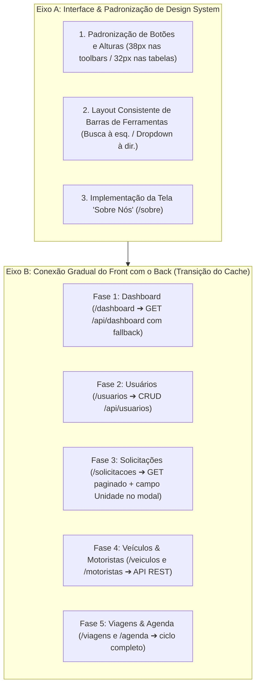

# Documentação do Front-end

Documento único do front-end. Atualize-o a cada nova tela ou mudança de padrão.

## 1. Stack
- **React 19 + TypeScript (modo estrito) + Vite 8**
- **Tailwind CSS v4 (`@tailwindcss/vite`)** com tokens institucionais centralizados na diretiva `@theme` em `src/styles/global.css` (zero arquivos `.css` secundários)
- **Design System em TypeScript**: variantes estritamente tipadas com `class-variance-authority` (`cva` + `VariantProps`) e fusão inteligente de classes com `clsx` + `tailwind-merge` (`src/utils/cn.ts`)
- **Padronização de Código**: `prettier` + `prettier-plugin-tailwindcss` para ordenação automática e determinística das classes utilitárias
- `react-router-dom` para roteamento e controle de acesso (RBAC)
- `lucide-react` para ícones vetoriais padronizados (sem emojis)
- **Vitest + React Testing Library** para testes automatizados de componentes e páginas

## 2. Como rodar
```bash
cd src/frontend
npm install
npm run dev          # Inicia o servidor de desenvolvimento em http://localhost:5173/
npm run build        # Confere tipos TypeScript (tsc -b) e gera o bundle de produção
npm test             # Executa a suíte de testes unitários e de integração (Vitest)
npm run format       # Formata o código e ordena classes Tailwind CSS com Prettier
npm run format:check # Verifica a formatação e ordenação de classes sem alterar arquivos
```

> [!IMPORTANT]
> **Atenção aos desenvolvedores**:
> 1. Ao atualizar ou clonar a branch, é obrigatório rodar `npm install` dentro de `src/frontend` para instalar os pacotes do Tailwind CSS v4 (`tailwindcss`, `@tailwindcss/vite`), `class-variance-authority`, `clsx`, `tailwind-merge` e `lucide-react`.
> 2. Crie o arquivo `src/frontend/.env` com `VITE_API_URL=http://localhost:3000/api` para comunicação correta com o back-end em desenvolvimento.

O front-end **está conectado ao back-end para os módulos centrais da operação**:
- **Autenticação e Sessão**: `POST /api/auth/login`, `GET /api/auth/me`.
- **Veículos**: `GET /api/veiculos`, `POST /api/veiculos`.
- **Motoristas**: `GET /api/motoristas`.
- **Viagens Operacionais**: `GET /api/viagens`, agendar, iniciar, finalizar e cancelar viagens via API.
- **Solicitações de Viagem**: `GET /api/solicitacoes-viagem`, criação, consulta de disponibilidade (`SCRUM-73`), aprovação e recusa com justificativa auditável (`SCRUM-74`).
- **Unidades & Gestores**: `GET /api/unidades`, integração com isolamento por unidade (BL15 / SCRUM-142).

Os módulos de **Dashboard**, **Usuários**, **Multas**, **Abastecimento** e **Agenda** encontram-se em fase de transição (endpoints do back-end já desenvolvidos, aguardando conexão dos serviços na interface conforme o roadmap).

## 3. Estrutura de pastas
```
src/frontend/
├─ public/assets/        logos e ícones institucionais
├─ .prettierrc           configuração do Prettier + prettier-plugin-tailwindcss
└─ src/
   ├─ contexts/          AuthContext (estado global da sessão e usuário logado)
   ├─ styles/            global.css (única folha de estilo: @import "tailwindcss", @theme e @layer base)
   ├─ utils/             cn.ts (helper clsx + tailwind-merge para resolução de conflitos de classes)
   ├─ components/
   │  ├─ ui/             Design System tipado (Button, Card, Badge, IdBadge, Avatar, Field, Input, Select,
   │  │                  Modal, ModalForm, Drawer, FilterBar, PlacaMercosul, Table, TableToolbar,
   │  │                  TableFilterCollapse, Pagination, MetricCard, Alert, PageHeader, ConfirmDialog,
   │  │                  EmptyState, icons)
   │  └─ layout/         AppLayout (sidebar retrátil com divisão de domínios, drawer mobile e topbar) e ErrorLayout
   ├─ pages/             uma página por rota + subpastas de modais/drawers por domínio e testes (*.test.tsx)
   │  ├─ veiculos/       DrawerDetalhesVeiculo.tsx e ModalManutencoesVeiculo.tsx
   │  ├─ viagens/        DrawerDetalhesViagem.tsx
   │  ├─ solicitacoes/   ModalAnaliseSolicitacao.tsx e ModalNovaSolicitacao.tsx
   │  ├─ abastecimento/  ModalAbastecimento.tsx
   │  ├─ multas/         ModalMulta.tsx
   │  └─ usuarios/       GestoresUnidadesSecao.tsx
   ├─ routes/            index.tsx (roteamento, redirecionamentos e navegação) e guards.tsx (RBAC)
   ├─ services/
   │  ├─ api/            http.ts (cliente HTTP), dashboardApi.ts e contratos REST por módulo
   │  ├─ mocks/          dados iniciais padronizados
   │  └─ storageService.ts persistência local no localStorage para os módulos em transição
   └─ types/             tipos TypeScript espelhando as entidades do banco e domínio
```

## 4. Arquitetura de Estilização e Boas Práticas (Tailwind CSS v4 + TypeScript)

O front-end adota um conjunto estrito de boas práticas de engenharia para garantir alta legibilidade, tipagem forte e manutenção escalável com **Tailwind CSS v4**:

1. **Reutilização via Componentes TypeScript (Zero `@apply`)**:
   - Não utilizamos a diretiva `@apply` nem arquivos `.css` por página. Toda reutilização visual acontece na camada de componentes React tipados em `src/components/ui/`.
2. **Combinação de Classes (`cn`) e Variantes Tipadas (`CVA`)**:
   - A função utilitária `cn(...inputs)` (`src/utils/cn.ts`) combina `clsx` e `tailwind-merge`, permitindo que qualquer componente base receba `className` via props e resolva conflitos de especificidade automaticamente (a última classe vence).
   - Componentes com múltiplas variações visuais (`Button`, `Badge`, `Alert`, `MetricCard`, `ConfirmDialog`) utilizam **`class-variance-authority` (`cva` + `VariantProps`)**, oferecendo autocompletar estrito no TypeScript.
3. **Proibição de Classes Dinâmicas Interpoladas**:
   - O compilador do Tailwind analisa os arquivos estaticamente. É **proibido** concatenar strings dinâmicas como ``className={`bg-${cor}-500`}``.
   - Sempre mapeie estados e enums (`StatusViagem`, `BadgeTone`, `MetricTone`, `ExcecaoAgenda['tipo']`) por meio de objetos estáticos tipados (`Record<Chave, string>`) ou variantes do `cva`.
4. **Tokens Centralizados (`@theme`) e Mobile-First**:
   - Cores institucionais (`bg-primary`, `bg-navy-900`, `text-text-muted`, `border-divider`), fontes (`font-sans`, `font-display`), raios (`rounded-modal`) e sombras (`shadow-card`, `shadow-modal`) estão declarados na diretiva `@theme` dentro de `src/styles/global.css`.
   - Os layouts seguem a filosofia **Mobile-First**: classes base descrevem a visualização mobile (`flex-col`, `grid-cols-1`, `hidden`) e os prefixos responsivos (`sm:`, `md:`, `lg:`) adaptam o layout para telas maiores.
   - A propriedade `style={{ ... }}` é restrita exclusivamente a coordenadas matemáticas calculadas em tempo de execução (como `left`/`width` proporcionais aos minutos nas barras do Gantt da Agenda e barras dinâmicas de progresso).
5. **Ordenação Automática de Classes (`prettier-plugin-tailwindcss`)**:
   - O plugin oficial do Prettier ordena automaticamente todas as classes Tailwind seguindo a ordem canônica oficial (layout → posicionamento → espaçamento → tipografia → cores → efeitos).

### 4.1 Catálogo de Componentes do Design System (`src/components/ui/`)
- **`Button` (`Button.tsx`)**:
  - Variantes CVA (`variant`): `'primary'` | `'ghost'` | `'outline'` | `'danger'` | `'success'`.
  - Tamanhos (`size`): `'md'` (padrão, controles principais e modais) e `'sm'` (ações inline em tabelas e barras de ferramentas).
- **`Badge` e `IdBadge` (`Badge.tsx`)**:
  - `Badge`: pílula semântica com indicador circular e variantes CVA (`tone`): `'success'` | `'warning'` | `'info'` | `'danger'` | `'neutral'` | `'purple'`.
  - `IdBadge`: selo monoespaçado padronizado para chaves primárias (`#1042`, placas).
- **`MetricCard` (`MetricCard.tsx`)**:
  - Card executivo de KPI utilizado no topo das telas operacionais (`Home`, `Dashboard`, `Veículos`, `Solicitações`, `Viagens`, `Motoristas`, `Abastecimento`, `Multas`, `Usuários`), com suporte a `label`, `value`, `subtitle`, `badge`, `icon`, `tone` (`blue` | `green` | `amber` | `red` | `purple` | `slate`) e `footer`.
- **`Alert` (`Alert.tsx`)**:
  - Caixa de feedback contextual com variantes CVA (`tone`: `'info'` | `'success'` | `'warning'` | `'danger'`), suporte a `title`, `icon` e botão de fechamento (`onClose`).
- **`ConfirmDialog` (`ConfirmDialog.tsx`)**:
  - Modal padronizado para confirmação de ações destrutivas ou críticas (`variant="danger"` | `"primary"`), substituindo o uso de `window.confirm` nativo em todo o sistema.
- **`PageHeader` (`PageHeader.tsx`)** e **`EmptyState` (`EmptyState.tsx`)**:
  - `PageHeader`: cabeçalho de página institucional com `eyebrow`, `title`, `subtitle` e slot `actions`.
  - `EmptyState`: estado vazio padronizado com ícone, título, descrição e ação de recuperação.
- **`Drawer` (`Drawer.tsx`)**:
  - Painel lateral deslizante (sheet) ancorado à direita com backdrop escurecido, suporte a tecla `Escape`, trava de scroll no body e foco acessível. Utilizado em `DrawerDetalhesVeiculo` e `DrawerDetalhesViagem` para inspeção profunda e auditoria sem perder o contexto da tabela subjacente.
- **`PlacaMercosul` (`PlacaMercosul.tsx`)**:
  - Componente de renderização visual de placas de veículos em conformidade com o padrão oficial Mercosul (topo azul com nome 'BRASIL', bandeira nacional e sigla 'BR' em tipografia monoespaçada) e suporte ao padrão convencional cinza (`variant="mercosul" | "padrao"`), disponível nos tamanhos `'sm'` e `'md'`.
- **`ModalForm`, `FormRow` e `ModalFooter` (`ModalForm.tsx`)**:
  - Estrutura tipada para composição de formulários modais de cadastro e edição (`ModalForm`), garantindo espaçamento vertical consistente, colunas responsivas (`FormRow`) e barra de botões de rodapé padronizada (`ModalFooter`).
- **`FilterBar` (`FilterBar.tsx`)**:
  - Barra consolidada de filtros com campo de busca textual e slots para dropdowns e ações de limpeza com micro-interações responsivas.
- **`Table`, `TableToolbar`, `TableFilterCollapse` e `Pagination` (`Table.tsx`)**:
  - `Table`: tabela responsiva com rolagem horizontal suave e ocultação automática de avatares em telas pequenas (`< 768px`).
  - `TableToolbar`: cabeçalho de tabela com título, subtítulo, botão de alternância de filtros mobile e CTA primário.
  - `TableFilterCollapse`: barra de filtros sempre visível no desktop (`md:flex`) e retrátil no mobile (`isOpen`).

## 5. Rotas e Permissões

| Rota | Página | Tipo de Acesso | Permissões |
|---|---|---|---|
| `/login` | `LoginPage` | Pública (`RotaPublica`) | Qualquer visitante (usuário logado é redirecionado para `/inicio`) |
| `/` | Redirecionamento | Protegida | Redireciona para `/inicio` |
| `/inicio` | `HomePage` | Protegida (`RotaProtegida`) | Qualquer usuário autenticado (visão geral, métricas via `dashboardApi` e atalho de Nova Solicitação) |
| `/dashboard` | `DashboardPage` | Protegida (`RotaProtegida`) | Qualquer usuário autenticado (métricas executivas e gráficos) |
| `/solicitacoes` | `SolicitacoesPage` | Protegida (`RotaProtegida`) | Qualquer usuário autenticado (triagem, análise de disponibilidade e despacho) |
| `/viagens` | `ViagensPage` | Protegida (`RotaProtegida`) | Qualquer usuário autenticado (acompanhamento operacional e Drawer de Detalhes) |
| `/agenda` | `AgendaPage` | Protegida (`RotaProtegida`) | Qualquer usuário autenticado |
| `/veiculos` | `VeiculosPage` | Protegida (`RotaProtegida`) | Qualquer usuário autenticado (frota ativa, Drawer de Detalhes e modal de manutenções) |
| `/abastecimento` | `AbastecimentoPage` | Protegida (`RotaProtegida`) | Qualquer usuário autenticado |
| `/manutencoes` | `ManutencoesPage` | Protegida (`RotaProtegida`) | Qualquer usuário autenticado (histórico de manutenções com IdBadge e controle de oficina) |
| `/multas` | `MultasPage` | Protegida (`RotaProtegida`) | Qualquer usuário autenticado (infrações e pontuação CNH) |
| `/equipe` | `EquipePage` | Restrita por Perfil (`RotaPorPerfil`) | Exclusivo para perfil `ADMINISTRADOR` (gestão integrada com abas de Motoristas e Usuários) |
| `/motoristas` | Redirecionamento | Protegida | Redireciona para `/equipe?aba=motoristas` |
| `/usuarios` | Redirecionamento | Restrita por Perfil | Redireciona para `/equipe?aba=usuarios` |
| `/sobre` | `SobreNosPage` | Protegida (`RotaProtegida`) | Qualquer usuário autenticado (apresentação institucional da FSPH, frota e créditos) |
| `/404`, `/500`, `/403` | Páginas de Erro | Pública / Erro | Telas ilustradas e padronizadas para cada código de erro HTTP |
| qualquer outra | `NotFoundPage` | Protegida | Exibida para rotas não mapeadas |

---

## 6. Arquitetura de Autenticação e Sessão

A autenticação é baseada em tokens **JWT (JSON Web Tokens)** e conecta o front-end diretamente à API do back-end (`http://localhost:3000/api`).

### 6.1 Fluxo Arquitetural

```text
[ Tela de Login (LoginPage) ]
              ↓
[ AuthContext (useAuth Hook) ]
              ↓
[ authApi.ts (Contrato de Endpoints) ]
              ↓
[ http.ts (Cliente HTTP com Interceptors & LocalStorage) ]
              ↓
[ API REST Express (JWT + PostgreSQL) ]
```

### 6.2 Componente Raiz (`App.tsx`)
O arquivo `src/frontend/src/App.tsx` é o componente raiz da aplicação. O provedor `<AuthProvider>` **obrigatoriamente** envolve o `<AppRoutes />` para fornecer o contexto de autenticação global para todos os componentes e guardas de rota:

```tsx
import { BrowserRouter } from 'react-router-dom'
import { AuthProvider } from './contexts/AuthContext'
import { AppRoutes } from './routes'

export default function App() {
  return (
    <BrowserRouter>
      <AuthProvider>
        <AppRoutes />
      </AuthProvider>
    </BrowserRouter>
  )
}
```

### 6.3 Cliente HTTP e Gestão de Tokens (`services/api/http.ts`)
Construído como um wrapper limpo e tipado sobre a Fetch API nativa do navegador:
- **Armazenamento de Token**: O token é persistido no `localStorage` sob a chave `'fsph.token'` pelo utilitário `tokenStorage`.
- **Injeção de Cabeçalho**: Em toda requisição autenticada, adiciona automaticamente `Authorization: Bearer <token>`.
- **Tratamento de Sessão Expirada (401)**: Se a API responder `401 Unauthorized` (ex.: após 8h de expiração do JWT), o token é limpo e um evento global `auth:expirada` é disparado, deslogando o usuário sem acoplamento direto com o React.
- **Tratamento de Erros (`ApiError`)**: Converte respostas de erro da API no formato padronizado `{ erro, detalhes }`, permitindo feedback amigável na interface.

### 6.4 Serviço de Autenticação (`services/api/authApi.ts`)
Encapsula os endpoints de autenticação do back-end:
- `login(email, senha)`: Dispara `POST /api/auth/login`. Recebe `{ token, tipo, expiraEm, usuario }`.
- `me()`: Dispara `GET /api/auth/me`. Restaura a sessão do usuário logado através do token salvo.
- `alterarSenha(senhaAtual, novaSenha)`: Dispara `PATCH /api/auth/senha`.

### 6.5 Estado Global e Hook `useAuth` (`contexts/AuthContext.tsx`)
Gerencia o ciclo de vida do usuário:
- **Auto-login ao iniciar (F5)**: Ao carregar a página, se houver token salvo, chama `authApi.me()` em segundo plano com indicador `carregando = true`.
- **Funções e Dados Expostos**:
  - `usuario`: Objeto com `id`, `nome`, `email`, `perfil`, `tipo_usuario`, `ativo`.
  - `carregando`: `true` enquanto verifica o token inicial.
  - `login(email, senha)`: Realiza a autenticação e armazena o token.
  - `logout()`: Limpa o token e encerra a sessão.
  - `temPerfil(...perfis)`: Helper booleano para validar se o usuário atual possui um determinado perfil (ex.: `temPerfil('ADMINISTRADOR')`).

### 6.6 Guardas de Rota e RBAC (`routes/guards.tsx` e `routes/index.tsx`)
- **`RotaPublica`**: Impede que usuários já autenticados acessem a tela de login (redireciona para `/dashboard`).
- **`RotaProtegida`**: Bloqueia acessos anônimos às telas do sistema. Grava em `location.state.de` a página que o usuário tentou acessar para redirecioná-lo automaticamente após o login.
- **`RotaPorPerfil`**: Implementa o controle de acesso baseado em papéis (RBAC). Bloqueia acesso a rotas não permitidas para o perfil do usuário logado.
- **Menu Lateral Dinâmico**: A barra lateral (`AppLayout`) filtra os itens navegáveis (`navItems`), exibindo apenas as abas compatíveis com o perfil do usuário logado.

### 6.7 Credenciais Padrão de Teste (Ambiente de Desenvolvimento)
Todos os usuários de teste usam a senha padrão: **`Senha@123`**

| Perfil | E-mail de Teste | Acesso no Front-end |
|---|---|---|
| Administrador | `admin@exemplo.com` | Acesso completo, incluindo gestão de Usuários (`/usuarios`) |
| Gestor de Frota | `gestor.frota@exemplo.com` | Dashboard, Agenda, Veículos, Motoristas, Viagens |
| Gestor SVO | `gestor.svo@exemplo.com` | Dashboard, Agenda, Veículos, Motoristas, Viagens do SVO |
| Solicitante | `solicitante@exemplo.com` | Dashboard, Agenda, Solicitações de Viagens |
| Motorista Frota | `motorista.frota@exemplo.com` | Dashboard, Agenda, Viagens |
| Motorista SVO | `motorista.svo@exemplo.com` | Dashboard, Agenda, Viagens |

---

## 7. Origem dos Dados e Status de Integração

A aplicação adota arquitetura híbrida em transição acelerada para API REST direta:

| Módulo / Tela | Origem Atual | Situação e Contrato |
|---|---|---|
| **Autenticação** (`/login`) | **API REST Real** (`authApi.ts`) | `POST /api/auth/login`, `GET /api/auth/me` com emissão e validação de JWT. |
| **Veículos** (`/veiculos`) | **API REST Real** (`veiculosApi.ts`) | `GET /api/veiculos`, `POST /api/veiculos` conectado ao PostgreSQL. |
| **Motoristas** (`/motoristas`) | **API REST Real** (`motoristasApi.ts`) | `GET /api/motoristas` com dados relacionais; cadastro aguarda `POST /api/motoristas`. |
| **Viagens** (`/viagens`) | **API REST Real** (`viagensApi.ts`) | Agendamento, início, conclusão com cálculo de odômetro e cancelamento via API. |
| **Solicitações** (`/solicitacoes`) | **API REST Real** (`solicitacoesApi.ts`) | Listagem paginada, criação, análise de recursos (`SCRUM-73`), aprovação e recusa com motivo (`SCRUM-74`). |
| **Unidades** (Seleção/Filtro) | **API REST Real** (`unidadesApi.ts`) | `GET /api/unidades` para isolamento operacional (BL15 / SCRUM-142). |
| **Início / Dashboard** (`/inicio`, `/dashboard`) | **API REST Real** (`dashboardApi.ts`) / Storage | Consumo de `GET /api/dashboard` (BL34) com agregação de métricas reais da frota, viagens e solicitações. |
| **Manutenções** (`/manutencoes`) | Storage (`storageService.ts`) | Padrão de Histórico operacional com `IdBadge` (`MAN-XXXX`), cards de status de oficina e integração pronta para `manutencaoRoutes.ts`. |
| **Equipe** (`/equipe`) | **API REST Real** (`motoristasApi.ts`) / Storage | Gestão centralizada em abas: Motoristas (API) e Usuários (Storage em transição para `/api/usuarios`). |
| **Multas / Infrações** (`/multas`) | Storage (`storageService.ts`) | Em transição: `GET /api/multas` e `POST /api/multas` prontos no backend. |
| **Abastecimento** (`/abastecimento`) | Storage (`storageService.ts`) | Em transição: `POST /api/abastecimentos` e `GET /api/abastecimentos/veiculo/:id` prontos no backend. |
| **Agenda** (`/agenda`) | Mocks (`agendaMock.ts`) | Em transição: estrutura preparada para consumo de viagens agendadas da API. |
| **Sobre Nós** (`/sobre`) | Componente Institucional Estático | Apresentação institucional da equipe (Squad 21) e atribuições na topbar. |

---

## 8. Tela de Veículos (`/veiculos`)
Tabela `veiculos`, conforme `docs/dicionario-de-dados.md` e as migrations.

| Coluna no banco | Regra | Campo no front |
|---|---|---|
| `id` | serial, PK | `id` (gerado localmente no mock / serial PostgreSQL) |
| `placa` | varchar(10), único | `placa` (renderizada via `<PlacaMercosul />`) |
| `modelo` | varchar(100) | `modelo` |
| `tipo_frota` | `ADMINISTRATIVA` ou `SVO` | `tipo_frota` |
| `capacidade_maxima` | inteiro, >= 0 | `capacidade_maxima` |
| `status` | padrão `DISPONIVEL` | `status` (`DISPONIVEL`, `RESERVADO`, `EM_USO`, `MANUTENCAO`) |

### Inovações de Interface em Veículos:
- **`DrawerDetalhesVeiculo.tsx`**: Painel lateral deslizante com abertura ao clicar em qualquer linha da tabela. Exibe:
  - Cabeçalho com placa Mercosul em destaque e status operacional;
  - Cards de métricas rápidas (Quilometragem atual, Consumo médio registrado e Capacidade);
  - Histórico recente de manutenções com atalho de cadastro direto;
  - Resumo de abastecimentos vinculados e especificações técnicas;
  - Rodapé de ações rápidas: registrar manutenção preventiva ou corretiva e visualizar logs de auditoria.
- **`ModalManutencoesVeiculo.tsx`**: Modal dedicado para consulta e abertura de ordens de serviço específicas do veículo selecionado, com alternância para colocar o veículo em manutenção imediata.

---

## 9. Tela de Manutenções (`/manutencoes`)
Tabela `manutencoes`, conectada às ordens de serviço preventivas e corretivas da frota FSPH.

| Métrica / Elemento | Origem no Banco / Storage | Regra de Negócio | Onde aparece |
|---|---|---|---|
| **Em oficina agora** | `manutencoes.status = 'EM_ANDAMENTO'` | **Card 1 Prioritário**: Quantidade de veículos retidos e indisponíveis para operação | Topo esquerdo (destaque vermelho/verde) |
| **Total investido** | `SUM(manutencoes.custo)` | Soma de custos de manutenções registradas | Card 2 de resumo |
| **Preventivas vs Corretivas** | `manutencoes.tipo_manutencao` | Contagem e proporção de manutenções planejadas vs corretivas emergenciais | Card 3 de resumo |
| **Concluídas no mês** | `manutencoes.status = 'CONCLUIDA'` | Ordens finalizadas com sucesso no mês corrente | Card 4 de resumo |
| **Identificador de Registro** | `manutencoes.id` | Formato padrão de identificador histórico `<IdBadge id="MAN-0001" />` | Coluna 1 da tabela |

### Padrão de Histórico e Ações Operacionais:
- **Histórico Unificado**: A tabela opera no mesmo padrão consolidado da tela de Abastecimento, trazendo a listagem histórica cronológica de todas as manutenções com busca e filtros por tipo e status.
- **Workflow de Oficina**:
  - Ordens `AGENDADA`: exibem botão contextual `[ Iniciar ]` que muda o status para `EM_ANDAMENTO` e automaticamente coloca o veículo como `MANUTENCAO`.
  - Ordens `EM_ANDAMENTO`: exibem botão contextual `[ Concluir ]` que finaliza o serviço e libera o veículo de volta para `DISPONIVEL`.
- **Exclusão Segura**: Todas as linhas possuem ação `[ Excluir ]` protegida por `<ConfirmDialog>`, garantindo integridade de registros.
- **Status Exclusivo**: O status do registro é exibido unicamente na coluna **Status** via `<Badge>`, eliminando duplicidades na coluna de ações.

---

## 10. Tela de Gestão de Equipe (`/equipe`)
Unificação da gestão operacional de pessoas da FSPH em uma única interface restrita a **Administradores**.

### Estrutura de Abas ("Pill Segmented"):
- A tela consolida o cadastro e acompanhamento de **Motoristas** e **Usuários** em duas abas horizontais com transição suave via CSS (`animate-tab-fade`):
  1. **Aba Motoristas (`/equipe?aba=motoristas`)**:
     - Visualização completa da tabela `motoristas` com 4 cards de topo (`Total de Motoristas`, `Frota`, `SVO` e `CNH Vencida`).
     - Alerta proativo de CNH expirada ou próxima do vencimento.
     - Filtros por tipo de motorista (`FROTA` / `SVO`) e status (`DISPONIVEL`, `DESIGNADO`, `EM_VIAGEM`, etc.).
  2. **Aba Usuários (`/equipe?aba=usuarios`)**:
     - Visualização da tabela `usuarios` com cards de status (`Ativos`, `Inativos`, etc.).
     - Filtros rápidos por perfil (`ADMINISTRADOR`, `GESTAO`, `SOLICITANTE`, `MOTORISTA`, `INATIVOS`).
     - Ações de redefinição de senha (`PATCH /api/usuarios/:id/senha`) e alternador de ativação/desativação.
     - Seção dedicada de **Gestores por Unidade (BL15)** para vinculação institucional (SVO, HEMOSE, LACEN).
- **Redirecionamentos Transparentes**: As rotas legadas `/motoristas` e `/usuarios` redirecionam automaticamente para `/equipe`, preservando compatibilidade de links antigos e histórico do navegador.
- **Removido do protótipo do Figma**:
  - Coluna "Último Acesso" (`ultimo`): não existe na tabela `usuarios`.
  - Status "Licença": no banco o status de conta é puramente booleano (`ativo: true/false`).
  - Perfis genéricos ("Administrador", "Gestor", "Operacional", "Motorista"): substituídos pelos 6 perfis oficiais da FSPH.
  - Toggle "É motorista?" e criação de CNH/Veículo no modal de usuário: `motoristas` é tabela e tela separada (`/motoristas`); veículos são alocados por viagem/ordem de serviço, não no cadastro do usuário.
- **Faltava no protótipo do Figma e foi incorporado**:
  - Modal administrativo para Redefinir Senha (`PATCH /api/usuarios/:id/senha`) com regras de senha forte.
  - Ação rápida para Ativar / Inativar usuário (`PATCH /api/usuarios/:id`).
  - Filtros rápidos por categoria e busca por nome ou e-mail.

### Como testar a Tela de Usuários:
1. Abra `http://localhost:5173/usuarios`.
2. Verifique os 4 cards de métricas no topo (`Total de Usuários`, `Ativos`, `Inativos` e `Motoristas Operacionais`).
3. Digite no campo de busca para filtrar por nome ou e-mail em tempo real.
4. Alterne entre as abas rápidas (`Todos`, `Administradores`, `Gestores`, `Solicitantes`, `Motoristas`, `Inativos`).
5. Clique em **Novo Usuário**, preencha os campos obrigatórios com perfil e senha forte (mínimo 8 dígitos com maiúscula, minúscula, número e símbolo) e salve para conferir o usuário inserido na lista.
6. Clique no botão **Senha** de qualquer usuário para abrir o modal de redefinição de senha.
7. Clique no botão **Desativar / Ativar** para alternar o status do usuário (note que o usuário administrador com tag "Você" tem o botão desativado por proteção de segurança).

### Gestores por unidade (BL15)
Seção abaixo da tabela de usuários (`pages/usuarios/GestoresUnidadesSecao.tsx`), visível só para `ADMINISTRADOR`. Consome a API diretamente, sem cache local, e recarrega após cada remoção.

- **Arquivos**: `types/unidade.ts` (tipos e regra de perfis), `services/api/unidadesApi.ts` (contrato) e a seção acima, renderizada em `UsuariosPage.tsx`.
- **Rotas consumidas** (backend da BL15, PR #76):

| Método | Rota | Uso no front |
|---|---|---|
| `GET` | `/api/unidades/gestores` | Lista as unidades com os gestores associados (`UnidadeComGestores[]`) |
| `POST` | `/api/unidades/:id/gestores` | Associa, com body `{ gestor_id }`; o 201 devolve a unidade atualizada, que substitui só aquela unidade na tela |
| `DELETE` | `/api/unidades/:id/gestores/:gestorId` | Remove a associação (204) |
| `GET` | `/api/usuarios?perfil=&ativo=true&limite=100` | Candidatos a gestor |
| `GET` | `/api/unidades` | `unidadesApi.listarOpcoes()`: opções `{ id, nome, tipo }` para a solicitação de viagem (ainda não usada na tela) |

- **Regra de perfis por unidade** (`PERFIS_GESTORES_POR_UNIDADE`, espelho de `backend/src/constants/unidades.ts`): **SVO** aceita Gestor de Frota e Gestor SVO; **HEMOSE** e **LACEN** aceitam só Gestor de Frota. O seletor de cada unidade já mostra só os perfis aceitos e esconde quem já está associado.
- **Estados da tela**: carregando, erro com "Tentar novamente", nenhuma unidade, unidade sem gestor e gestor inativo (badge). Erros 400, 403, 404 e 409 da API viram mensagens de feedback.
- **Dependência de banco**: as tabelas `unidades` e `gestores_unidades` e a coluna `solicitacoes_viagem.unidade_id` ainda não têm migration (ver seção 14). Até lá, a API responde 500 e a seção mostra o estado de erro.

#### Como testar (depois da migration)
1. Entre como administrador e abra `/usuarios`; role até **Gestores por unidade**.
2. Confira as 3 unidades (SVO, HEMOSE, LACEN) e o aviso "Nenhum gestor associado" nas que estiverem vazias.
3. No SVO, o seletor deve listar Gestores de Frota e Gestores SVO; em HEMOSE e LACEN, só Gestores de Frota.
4. Associe um gestor e confira que ele aparece na unidade e some do seletor dela.
5. Clique em **Remover**, confirme e veja o gestor voltar ao seletor.

## 10. Tela de Dashboard
Painel central consolidado que agrega indicadores operacionais das tabelas `solicitacoes_viagem`, `viagens_frota`, `veiculos`, `motoristas` e `usuarios`.

| Métrica / Elemento | Origem no Banco | Regra de Cálculo no Front | Onde aparece |
|---|---|---|---|
| `Solicitações Pendentes` | `solicitacoes_viagem.status` | Contagem com status `PENDENTE_APROVACAO` | Card 1 de resumo |
| `Viagens em Andamento` | `viagens_frota.status` | Contagem com status `EM_ANDAMENTO` | Card 2 de resumo |
| `Veículos Disponíveis` | `veiculos.status` | Contagem com status `DISPONIVEL` | Card 3 de resumo |
| `Frota Administrativa / SVO` | `veiculos.tipo_frota` | Subdivisão de veículos disponíveis (`ADMINISTRATIVA` vs `SVO`) | Card 3 (badges de rodapé) |
| `Alertas da Operação` | `veiculos.status` e `motoristas.validade_cnh` | Veículos em `MANUTENCAO` + motoristas com CNH vencida | Card 4 de resumo |
| `Tabela de Solicitações Recentes` | `solicitacoes_viagem` (join `usuarios`) | Lista das últimas solicitações com solicitante, trajeto e status | Tabela principal |

- **Cards de Sumário**:
  1. *Solicitações Pendentes*: exibe pedidos que exigem despacho do gestor, com botão de navegação direta para `/viagens`.
  2. *Viagens em Andamento*: resumo das viagens em curso no dia, discriminando horário, rota e veículo.
  3. *Veículos no Pátio*: quantitativo de veículos prontos para operação, segregados pela regra de negócio do banco (`ADMINISTRATIVA` e `SVO`).
  4. *Alertas da Operação*: monitoramento proativo de veículos em manutenção e motoristas com habilitação vencida.
- **Tabela de Solicitações**:
  - Exibe o **Solicitante** (`usuarios.nome`), trajeto (`origem → destino`), data desejada, finalidade e status real do banco (`PENDENTE_APROVACAO`, `APROVADA`, `REJEITADA`).
- **Removido do protótipo do Figma**:
  - Sub-rótulos "Passeio" e "Amb.": substituídos pelas categorias reais da modelagem do banco (`ADMINISTRATIVA` e `SVO`).
  - Status "Manutenção" em solicitações: no banco, manutenção é exclusiva de `veiculos` e `manutencoes`.
  - Motorista em solicitações pendentes: no modelo relacional, a solicitação pertence a `solicitante_id`. O motorista só é alocado na viagem após a aprovação do gestor.
  - IDs alfanuméricos fictícios (`SOL-1042`): no banco os IDs são inteiros (`#1042`).

### Como testar a Tela de Dashboard:
1. Abra `http://localhost:5173/dashboard` (ou a raiz `http://localhost:5173/`).
2. Confira os 4 cards de sumário no topo e a consistência dos números com os dados cadastrados em Veículos e Motoristas.
3. Teste os botões de navegação dos cards (ex: "Ver frota →" e "Ver motoristas →") para confirmar o direcionamento às respectivas telas.
4. Confira a tabela de solicitações recentes com solicitante, trajeto formatado e badges de status.

## 11. Tela de Viagens
Tabelas `viagens_frota`, `solicitacoes_viagem` e `ordens_svo`, conforme as migrations e as regras de negócio do Squad 21 (RN01–RN05, RN07, RN21 e RF11–RF15).

| Coluna no banco | Regra / Tipo | Campo no front (`types/viagem.ts`) | Onde aparece |
|---|---|---|---|
| `id` | serial, PK | `id` | gerado localmente nos mocks / PK relacional |
| `solicitacao_id` | FK `solicitacoes_viagem.id` | `solicitacao_id` | vínculo relacional com o pedido institucional |
| `tipo_operacao` | regra do banco (tabela) | `tipo_operacao` (`ADMINISTRATIVA` ou `SVO`) | tabela (badge), filtros e modais |
| `veiculo_id` | FK `veiculos.id` | `veiculo_id`, `veiculo_modelo`, `veiculo_placa` | tabela, badge de placa e modais |
| `motorista_id` | FK `motoristas.id` | `motorista_id`, `motorista_nome` | tabela, avatar e modais |
| `km_inicial` | integer, odômetro de saída | `km_inicial` | tabela e modais de agendamento/retorno |
| `km_final` | integer, odômetro de retorno | `km_final` | tabela e modal de finalização |
| `data_hora_efetiva_saida` | timestamp | `data_hora_efetiva_saida` | tabela e modal de detalhes |
| `data_hora_efetiva_chegada` | timestamp | `data_hora_efetiva_chegada` | tabela e modal de detalhes |
| `status` | varchar(30), default `AGENDADA` | `status` (`AGENDADA`, `EM_ANDAMENTO`, `CONCLUIDA`, `CANCELADA`) | tabela (badges) e abas de filtro |

### Rastreabilidade: Figma vs. Banco de Dados / Produto Real (Viagens)
| Critério | No Protótipo do Figma | No Banco / Back-end Real | Decisão de Projeto & Motivo |
|---|---|---|---|
| **Vínculo da Viagem** | Viagem criada de forma solta/avulsa | Toda viagem nasce de uma solicitação aprovada (`solicitacoes_viagem.id`) | **Adequado ao Banco**: cumpre o fluxo de governança RN01–RN03 (Solicitação → Análise do Gestor → Agendamento). |
| **Quilometragem / Distância** | Distância estática em texto ("99 km") | Odômetro de saída (`km_inicial`) e retorno (`km_final`) | **Adequado ao Banco**: a distância percorrida é apurada por `km_final - km_inicial`. |
| **Identificadores (IDs)** | Strings fictícias (`VIA-0881`) | Identificadores inteiros seriais (`id: integer`) | **Adequado ao Banco**: IDs formatados visualmente como `#881`, mantendo a integridade com o banco. |
| **Separação de Frotas** | Itinerários misturados sem divisão de operação | Separação explícita entre Frota Administrativa (`viagens_frota`) e SVO (`ordens_svo`) | **O Banco tem a mais**: implementadas abas e identificadores de operação para cumprir a **RN21**. |
| **Passageiros / Carga** | Lista de passageiros avulsos no modal | O pedido institucional registra solicitante e finalidade | **Removido do Figma**: não existe tabela de passageiros individuais no banco de dados. |
| **Status da Viagem** | "Em Andamento", "Agendada", "Concluída" | `AGENDADA`, `EM_ANDAMENTO`, `CONCLUIDA`, `CANCELADA` | **Alinhado ao Banco**: suporte aos 4 estados operacionais previstos na modelagem. |

### Composição e Otimização da Tabela & Ticket de Viagem Inline:
- **Linha Clicável com Ticket de Viagem Expansível**: Toda a linha da tabela é interativa (`cursor: pointer` com hover suave e destaque ativo `is-expanded`). Ao clicar em qualquer viagem, ela expande inline um **Ticket de Viagem / Manifesto de Bordo** corporativo e limpo.
- **Cabeçalho Corporativo e Limpo**: Fundo neutro suave (`var(--color-surface-alt)`), identificador em destaque `Viagem #ID`, tipo de frota institucional (`Frota Administrativa` ou `SVO`) e referência da `Solicitação #ID`, com botão discreto de fechar e sem bordas ou gradientes artificiais.
- **Percurso Cronológico e Rótulos Claros**:
  - Origem e Destino com rótulos diretos ("Origem" e "Destino"), trazendo o horário de saída (`Saída: HH:mm`) logo abaixo da origem e a previsão/retorno (`Chegada: HH:mm`) abaixo do destino.
  - Ponto central da rota com indicador de distância consolidada (`35 km`), sem duplicar a duração no centro do trajeto.
- **Auditoria de Odômetro e Tempo (Canhoto Lateral)**:
  - Controle estrito de `Km Inicial` e `Km Final`, calculando a `Distância percorrida` apurada.
  - Métrica técnica de `Duração do Percurso` calculada dinamicamente entre as datas efetivas de saída e chegada (`data_hora_efetiva_chegada - data_hora_efetiva_saida`), sem requerer colunas extras no banco.
  - Botão **Imprimir Manifesto** preservado esteticamente como esboço de interface no canhoto.
- **Blocos Contextuais de Agentes**:
  - **Condutor Responsável**: Nome do motorista e categoria da CNH (dados reais da tabela `motoristas`).
  - **Veículo Alocado**: Modelo e placa do veículo (dados reais da tabela `veiculos`).
  - **Solicitante Institucional**: Nome do solicitante e cargo/vínculo, eliminando redundâncias visuais de repetição do ID da solicitação.
  - **Finalidade / Justificativa**: Exibe o motivo oficial registrado na solicitação de viagem.
- **Remoção do Botão de Detalhes**: Com a abertura direta do Ticket pelo clique na linha, o botão "Detalhes" foi removido da última coluna, liberando espaço horizontal sem poluição visual.
- **Unificação de Horários na Tabela**: Em vez de ocupar duas colunas inteiras isoladas para `Partida` e `Chegada`, os horários foram unificados em uma única coluna hierárquica **Horários**, exibindo Saída, Chegada / Em trânsito / Aguardando saída com micro-indicadores de status.
- **Hierarquia do Trajeto**: A coluna **Origem / Destino** utiliza indicador visual com ícone de pin na origem e conector `↳` no destino, permitindo que trajetos longos respirem com limite de quebra em 2 linhas sem espremer o restante da tabela.
- **Contenção e Espaçamentos do Card**: Ajustado o padding horizontal padrão de células da tabela para 14px (com 20px nas extremidades alinhados à barra de ferramentas) e aplicada contenção `min-width: 0; max-width: 100%` no container `.card`, evitando estouros horizontais quando a sidebar estiver aberta em desktops e laptops.
- **Drawer de Detalhes da Viagem (`DrawerDetalhesViagem.tsx`)**:
  - A visualização detalhada da viagem evoluiu para um **Drawer lateral** deslizante (`<Drawer>`), permitindo inspecionar o manifesto de bordo, odômetro auditado, motorista, veículo, horários e finalidade sem perder o contexto da listagem nem distorcer a paginação da tabela.
  - Acesso direto ao clicar na linha da tabela ou no ícone de detalhes (`ChevronRight`).
  - Suporte a ações operacionais contextualizadas: iniciar viagem, registrar retorno/odômetro final e cancelamento com confirmação.

### Como testar a Tela de Viagens:
1. Abra `http://localhost:5173/viagens`.
2. Confira os 4 cards de métricas no topo (`Total de Viagens`, `Em Andamento`, `Agendadas` e `Concluídas`).
3. Alterne as abas de filtro: `Todas`, `Em Andamento`, `Agendadas`, `Concluídas`, `Frota` e `SVO`.
4. Digite no campo de busca para filtrar por trajeto, condutor ou placa em tempo real.
5. Clique em qualquer linha da tabela para abrir o **Drawer de Detalhes da Viagem**, com manifesto completo, métricas de odômetro e rota auditada.
6. Clique em **Nova Viagem** para vincular uma solicitação aprovada a um veículo e motorista disponíveis com registro de odômetro inicial.
7. Em uma viagem com status `Em Andamento`, clique em **Finalizar** (na tabela ou dentro do próprio drawer) para preencher o odômetro final (`km_final`) e registrar a conclusão da viagem.

## 12. Tela de Agenda (`/agenda`)
Painel de alocação temporal e monitoramento da frota, alimentado pelas tabelas `viagens_frota`, `solicitacoes_viagem`, `veiculos` e `motoristas`.

A tela organiza visualmente o uso dos recursos (veículos e motoristas) ao longo do tempo, permitindo ao gestor identificar janelas livres, planejar despachos futuros e prevenir conflitos operacionais.

### Mapeamento dos Dados:
| Coluna no banco / Tabela | Tipo | Campo no front (`types/agenda.ts`) | Onde aparece na Agenda |
|---|---|---|---|
| `viagens_frota.id` | serial, PK | `id` | Identificador visual `#ID` no modal e blocos |
| `veiculos.id` / `placa` / `modelo` | relacional | `veiculo_id`, `veiculo_placa`, `veiculo_modelo` | Eixo Y de recursos em Hoje e Semana |
| `motoristas.id` / `usuarios.nome` | relacional | `motorista_id`, `motorista_nome` | Sub-rótulo de recurso e modal de detalhes |
| `solicitacoes_viagem.origem` | varchar(255) | `origem` | Bloco da rota e título do modal |
| `solicitacoes_viagem.destino` | varchar(255) | `destino` | Bloco da rota e título do modal |
| `solicitacoes_viagem.finalidade` | text | `finalidade` | Modal de detalhes da viagem |
| `usuarios.nome` (solicitante) | varchar(150) | `solicitante_nome` | Modal de detalhes (substitui passageiros fictícios) |
| `veiculos.capacidade_maxima` | integer | `capacidade_maxima` | Lotação máxima oficial do veículo alocado |
| `data_hora_efetiva_saida` ou prevista | timestamp | `data_hora_saida` | Posição inicial do bloco (`left`) |
| `data_hora_efetiva_chegada` ou prevista | timestamp | `data_hora_chegada` | Posição final e largura do bloco (`width`) |
| `viagens_frota.status` | enum/varchar | `status` (`AGENDADA`, `EM_ANDAMENTO`, `CONCLUIDA`, `CANCELADA`) | Cores dos blocos e badges |

### Rastreabilidade: Figma vs. Banco de Dados / Produto Real (Agenda)
| Critério | No Protótipo do Figma | No Banco / Back-end Real | Decisão de Projeto & Motivo |
|---|---|---|---|
| **Passageiros / Carga** | Lista de passageiros avulsos e lotação ("3/5 vagas") no modal | Não existe tabela de passageiros avulsos no PostgreSQL. O vínculo é institucional (`solicitante_id` e `finalidade`). | **Removido do Figma**: Substituído pelo solicitante institucional (`usuarios.nome`), finalidade oficial do serviço e capacidade máxima cadastrada do veículo (`veiculos.capacidade_maxima`). |
| **Identificadores das Viagens** | Strings arbitrárias (`VIA-0881`, `W01`) | Identificadores seriais inteiros (`id: integer`) | **Adequado ao Banco**: Formatados no padrão visual institucional `#881`. |
| **Status da Viagem** | Textos livres com acento ("Concluída", "Em Andamento", "Agendada") | Enums padronizados em caixa alta (`AGENDADA`, `EM_ANDAMENTO`, `CONCLUIDA`, `CANCELADA`) | **Alinhado ao Banco**: Utiliza a mesma chave de status e estilo unificado de badges de `/viagens`. |
| **Ícones e Alertas de Exceção** | Emojis textuais (`🔴`, `⚠️`, `🟢`) na visão Mês | Proibido pelo design system do projeto | **Removido do Figma**: Substituído por ícones vetoriais padronizados `lucide-react` (`AlertCircle`, `AlertTriangle`, `CheckCircle2`, `Clock`). |
| **Quilometragem / Distância** | Texto estático solto ("99 km") | Cálculo a partir do odômetro (`km_final - km_inicial`) ou estimativa de trajeto | **Adequado ao Banco**: Exibição da distância apurada ou planejada em conformidade com o odômetro. |
| **Estilos & Layout** | Tailwind CSS e cores inline soltas | **Tailwind CSS v4 (`@theme`) + Mapas Estáticos TypeScript** | **Adequado ao Padrão**: Tokens institucionais em `global.css` (`@theme`) e coordenadas matemáticas de tempo via `style` dinâmico. |

### Composição das 3 Visualizações da Agenda:
1. **Modo "Hoje" (Gantt Horário Interativo)**:
   - Grade temporal contínua das **05:00 às 20:00** (80px por hora).
   - Marcador vertical dinâmico do **"Agora"** (linha azul destacada com relógio em tempo real).
   - Eixo Y com veículos (modelo e placa) e condutores responsáveis.
   - Posicionamento matemático proporcional dos blocos (`left` e `width` calculados por minutos a partir das 05h).
   - Scroll horizontal sincronizado entre o cabeçalho de horários e a grade de recursos.
2. **Modo "Semana" (Mini-Timeline de 7 Dias)**:
   - Colunas de Segunda a Domingo com destaque circular no dia atual.
   - Eixo Y com veículos da frota.
   - Barras compactas proporcionais ao percurso com **tooltip flutuante no hover** exibindo horários e rota.
   - Clique em qualquer barra abre o modal de detalhes da viagem.
3. **Modo "Mês" (Calendário de Gestão por Exceção)**:
   - Calendário mensal 7x5 focado em **Gestão por Exceção**: dias sem ocorrências mantêm visual neutro e limpo.
   - Dias passados exibem apenas o consolidado discreto de viagens realizadas.
   - Dias futuros com alertas exibem chips informativos:
     - `Gargalo`: escassez de veículos/motoristas.
     - `Pico`: horários de alta demanda com poucos veículos livres.
     - `Normal`: capacidade equilibrada.
   - Clique em um dia com exceção transiciona automaticamente para a visão detalhada do dia.

### Como testar a Tela de Agenda:
1. Acesse `http://localhost:5173/agenda`.
2. Alterne entre as 3 abas de visualização: **Hoje**, **Semana** e **Mês**.
3. Na visão **Hoje**, confira a régua horária das 05h às 20h, o marcador vertical do horário atual e o scroll horizontal sincronizado.
4. Na visão **Semana**, passe o mouse sobre os blocos diários para verificar o tooltip com horário e rota.
5. Na visão **Mês**, confira a grade de calendário e os chips de gestão por exceção com ícones `lucide-react`.
6. Clique em qualquer viagem (em Hoje ou Semana) para abrir o **Modal de Detalhes da Viagem**, conferindo o trajeto, horários, motorista, veículo e justificativa institucional (sem passageiros avulsos fictícios).

## 13. Matriz de Rastreabilidade Geral (Figma vs. Banco de Dados / Produto Real)

Visão geral consolidada de todas as adequações realizadas entre o protótipo visual (Figma) e o sistema real (Banco e Back-end):

| Módulo / Tela | O que o Figma tinha a mais (Removido do produto real) | O que o Banco / Produto Real tem a mais (Não existia no Figma) |
|---|---|---|
| **Veículos (`/veiculos`)** | - Ano de fabricação e Km atual no cadastro estático<br>- Motorista fixo vinculado ao veículo<br>- Categorias "Caminhão" e "Van"<br>- Status "Inativo" e "Em Viagem" | - `tipo_frota`: `ADMINISTRATIVA` e `SVO` obrigatórios<br>- `capacidade_maxima` de lotação obrigatória<br>- Status oficiais: `DISPONIVEL`, `EM_USO`, `MANUTENCAO` |
| **Motoristas (`/motoristas`)** | - Telefone e contador de viagens acumuladas<br>- Veículo fixo vinculado<br>- Status "Ativo", "Em Viagem" e "Licença" | - `numero_cnh`, `categoria_cnh` (A–E) e `validade_cnh`<br>- Alerta proativo de CNH vencida calculado no front<br>- `tipo_motorista`: `FROTA` e `SVO`<br>- Vínculo relacional `usuario_id` com a tabela `usuarios` |
| **Usuários (`/usuarios`)** | - Coluna "Último Acesso" (`ultimo`)<br>- Status "Licença"<br>- Perfis fictícios ("Gestor", "Operacional")<br>- Toggle "É motorista?" criando CNH e alocando veículo no modal | - 6 perfis oficiais FSPH (`ADMINISTRADOR`, `SOLICITANTE`, `GESTOR_FROTA`, `GESTOR_SVO`, `MOTORISTA_FROTA`, `MOTORISTA_SVO`)<br>- `tipo_usuario` derivado por constraint<br>- Rota de Redefinir Senha (`PATCH /api/usuarios/:id/senha`) com regras de senha forte<br>- Ação de Ativar/Desativar conta com autoproteção do admin logado |
| **Dashboard (`/dashboard`)** | - Sub-rótulos "Passeio" e "Amb."<br>- Status "Manutenção" em solicitações de viagem<br>- IDs com string (`SOL-1042`)<br>- Motorista fixado antes da aprovação da solicitação | - Segregação real da frota (`ADMINISTRATIVA` vs `SVO`)<br>- Alertas unificados de manutenção de veículos e CNH vencida<br>- Vínculos relacionais com solicitantes institucionais (`solicitacoes_viagem`) |
| **Viagens (`/viagens`)** | - Viagem avulsa sem solicitação institucional vinculada<br>- Distância fixa como texto arbitrário ("99 km")<br>- Lista fictícia de passageiros avulsos<br>- IDs com string (`VIA-0881`) | - Vínculo relacional obrigatório com `solicitacao_id` aprovada (RN01–RN03)<br>- Controle estrito por odômetro (`km_inicial`, `km_final`, distância apurada)<br>- Segregação de frotas (Frota Adm vs SVO) conforme RN21<br>- Ação de despacho e registro de retorno pelo motorista/gestor |
| **Agenda (`/agenda`)** | - Lista fictícia de passageiros avulsos e vagas ("3/5 vagas")<br>- IDs com string (`VIA-0881`, `W01`)<br>- Emojis de alerta (`🔴`, `⚠️`, `🟢`)<br>- Status em texto livre ("Concluída", "Em Andamento") | - Vínculo relacional institucional (`solicitacoes_viagem` e `viagens_frota`)<br>- Capacidade máxima oficial do veículo (`veiculos.capacidade_maxima`)<br>- Solicitante e justificativa institucional da viagem<br>- Status enum padrão do banco (`AGENDADA`, `EM_ANDAMENTO`, `CONCLUIDA`, `CANCELADA`)<br>- Ícones vetoriais padronizados `lucide-react` |
| **Identidade / Ícones** | - Emojis textuais e SVGs soltos | - Biblioteca profissional padronizada `lucide-react` em todas as telas |

## 14. Tela "Sobre Nós" (`/sobre`)

Página institucional acessível a todos os usuários autenticados através da barra de navegação ou rodapé do sistema. Apresenta o contexto e a governança da plataforma de frotas da Fundação de Saúde Parreiras Horta.

- **Composição da Tela**:
  1. **Cabeçalho Institucional**: Logo oficial da FSPH, missão da fundação na gestão da saúde pública estadual e objetivo do sistema de gestão integrada de frotas.
  2. **Unidades Operacionais Atendidas**:
     - **SVO (Serviço de Verificação de Óbito)**: Operação especializada com regime de escalas e plantões 24h.
     - **HEMOSE (Centro de Hemoterapia de Sergipe)**: Logística de transporte de hemoderivados e doadores.
     - **LACEN (Laboratório Central de Saúde Pública)**: Coleta e distribuição de amostras biológicas e exames diagnósticos.
  3. **Especificações Técnicas e Arquitetura**:
     - Stack: React 19, TypeScript, Tailwind CSS v4 (`@theme` + CVA), Express, Knex, PostgreSQL.
     - Versão atual da plataforma e ambiente de execução.
  4. **Créditos do Projeto**:
     - Projeto desenvolvido no âmbito da **Residência em Software III (Squad 21)**.

---

## 15. Status de Integração com o Back-end
- **Autenticação & Sessão**: Conectada e validada em produção (`/api/auth/login`, `/api/auth/me`).
- **Unidades e Gestores (BL15)**: Concluída no backend e banco de dados via PR #76 e PR #82. Endpoints `/api/unidades` e `/api/unidades/gestores` ativos.
- **Indicadores do Dashboard (BL34)**: Endpoint consolidado entregue no backend via PR #81 (`GET /api/dashboard`).
- **Usuários**: Endpoints CRUD completos no backend (`/api/usuarios`).
- **Solicitações de Viagem**: Endpoints completos com suporte a `unidade_id`, paginação e análise de disponibilidade (`/api/solicitacoes-viagem`).
- **Viagens e Agenda**: Endpoints de listagem e controle de odômetro em desenvolvimento/revisão.

---

## 16. Roadmap Consolidado de Execução (UI & Conexão Back-end)

A estratégia de evolução do sistema combina a padronização estética/ergonômica com a transição segura dos dados em cache para a API REST:



### Detalhamento das Entregas

#### Eixo A: Padronização Visual & UX
1. **Unificação de Controles nas Telas Operacionais**:
   - Ajustar `VeiculosPage`, `MotoristasPage`, `SolicitacoesPage`, `ViagensPage`, `UsuariosPage`, `AbastecimentoPage` e `MultasPage` para que o campo de busca (`Input`), o seletor de status (`Select`) e os botões de ação (`Button`) compartilhem rigorosamente a altura de `38px`.
   - Garantir que ações inline nas tabelas utilizem exclusivamente `size="sm"` (`32px`).
   - Posicionar a busca textual sempre à esquerda e os dropdowns com CTA de cadastro à direita.
2. **Tela "Sobre Nós" (`/sobre`)**:
   - Criação da página institucional corporativa FSPH com layout em cards neutros e identidade visual formal.

#### Eixo B: Conexão do Front com o Back
1. **Fase 1 — Dashboard (`/dashboard`)**:
   - Consumir `GET /api/dashboard?inicio=&fim=`.
   - Implementar fallback transparente para o `storageService` caso a rede esteja indisponível.
   - Corrigir link de "Revisar" no card de solicitações pendentes para apontar para `/solicitacoes`.
2. **Fase 2 — Usuários (`/usuarios`)**:
   - Conectar tabela e modais de usuário às rotas `/api/usuarios`, mantendo feedback por toast/alertas.
3. **Fase 3 — Solicitações de Viagem (`/solicitacoes`)**:
   - Adicionar o dropdown de seleção de Unidade no `ModalNovaSolicitacao.tsx` alimentado por `unidadesApi.listarOpcoes()`.
   - Conectar a listagem paginada (`GET /api/solicitacoes-viagem`) e as ações de aprovar/recusar.
4. **Fases 4 e 5 — Veículos, Motoristas, Viagens e Agenda**:
   - Conectar as rotas correspondentes conforme o backend for homologado.

#### 🟢 Nível 1: Cadastros em Cache de Veículos e Motoristas (Ponto de Partida)
- **Objetivo**: Fornecer a base cadastral da frota persistida no navegador sem dependência de backend imediato.
- **Entregáveis**:
  - Utilitário central de cache local (`storageService.ts`) populado inicialmente com os mocks oficiais caso o `localStorage` esteja vazio.
  - `VeiculosPage`: ao salvar um novo veículo, adiciona no cache, insere no topo da listagem e recalcula os contadores.
  - `MotoristasPage`: ao cadastrar novo condutor, grava no cache, atualiza a tabela e atualiza os contadores de frota/SVO e CNHs vencidas.

#### 🟡 Nível 2: Usuários e Sincronização Cruzada
- **Objetivo**: Conectar o ecossistema para que ações em uma tela repercutam nas demais.
- **Entregáveis**:
  - Persistência das mutações em `UsuariosPage` (edições, novos usuários, senhas redefinidas).
  - Modal `ModalNovaViagem`: dropdowns dinâmicos consumindo veículos e motoristas ativos e disponíveis direto do cache.

#### 🟠 Nível 3: Regras de Negócio de Viagens e Solicitações
- **Objetivo**: Operar o fluxo de vida completo da viagem conforme as regras da FSPH.
- **Entregáveis**:
  - Validação estrita de odômetro de retorno (`km_final >= km_inicial`).
  - Mudança automática de estados: veículo alocado passa para `EM_USO`; veículo finalizado volta para `DISPONIVEL`.
  - Ações de aprovação/rejeição no painel de solicitações do Dashboard.

#### 🔴 Nível 4 a 6: Agenda, Login e Integração de Rede
- **Objetivo**: Fechar o ciclo do sistema com a experiência completa de agendamento visual, autenticação segura e comunicação cliente-servidor real via endpoints REST.

---

## 16. Guia Técnico de Transição: Mocks ➔ Back-end Real & API REST

Este guia detalha o plano de chaveamento arquitetural para substituir os dados simulados (`services/mocks/`) pelas chamadas HTTP reais aos endpoints do back-end Node.js / PostgreSQL.

### Por que as telas já estão 90% prontas?
1. **Fidelidade de Schema**: Todas as interfaces em `src/frontend/src/types/` foram modeladas estritamente a partir do banco PostgreSQL (`veiculos`, `motoristas`, `usuarios`, `solicitacoes_viagem`, `viagens_frota`).
2. **Zero Campos Fictícios**: Foram removidos todos os dados arbitrários do Figma que não possuem sustentação relacional (como listas avulsas de passageiros, tags de telefone estáticas e emojis).
3. **Identificadores e Enums Oficiais**: As telas já esperam IDs inteiros (`number`) e enums padronizados em caixa alta (`DISPONIVEL`, `EM_ANDAMENTO`, `AGENDADA`, etc.).

---

### 🗺️ Matriz de Mapeamento: Telas vs. Endpoints REST da API

| Módulo / Tela | Ação no Front | Endpoint no Back-end | Verbo HTTP | Status Esperado | Payload / Retorno |
|---|---|---|---|---|---|
| **Usuários (`/usuarios`)** | Listar usuários | `/api/usuarios` | `GET` | `200 OK` | `Usuario[]` (já implementado no back) |
| **Usuários (`/usuarios`)** | Criar usuário | `/api/usuarios` | `POST` | `201 Created` | `{ nome, email, senha, perfil }` ➔ `Usuario` |
| **Usuários (`/usuarios`)** | Editar usuário | `/api/usuarios/:id` | `PATCH` | `200 OK` | `{ nome, email, perfil, ativo }` |
| **Usuários (`/usuarios`)** | Redefinir senha | `/api/usuarios/:id/senha` | `PATCH` | `200 OK` | `{ senhaAtual, novaSenha }` |
| **Veículos (`/veiculos`)** | Listar frota | `/api/veiculos` | `GET` | `200 OK` | `Veiculo[]` |
| **Veículos (`/veiculos`)** | Cadastrar veículo | `/api/veiculos` | `POST` | `201 Created` | `{ placa, modelo, tipo_frota, capacidade_maxima }` |
| **Veículos (`/veiculos`)** | Alterar status | `/api/veiculos/:id/status`| `PATCH` | `200 OK` | `{ status: 'DISPONIVEL' \| 'MANUTENCAO' }` |
| **Motoristas (`/motoristas`)** | Listar condutores | `/api/motoristas` | `GET` | `200 OK` | `Motorista[]` (com join de `usuarios.nome`) |
| **Motoristas (`/motoristas`)** | Cadastrar motorista | `/api/motoristas` | `POST` | `201 Created` | `{ usuario_id, numero_cnh, categoria_cnh, validade_cnh, tipo_motorista }` |
| **Viagens (`/viagens`)** | Listar viagens | `/api/viagens` | `GET` | `200 OK` | `Viagem[]` (filtros opcionais `?status=&tipo=`) |
| **Viagens (`/viagens`)** | Despachar nova viagem | `/api/viagens` | `POST` | `201 Created` | `{ solicitacao_id, veiculo_id, motorista_id, km_inicial, data_hora_saida }` |
| **Viagens (`/viagens`)** | Finalizar viagem | `/api/viagens/:id/finalizar` | `PATCH` | `200 OK` | `{ km_final, data_hora_chegada }` |
| **Agenda (`/agenda`)** | Buscar visão do dia | `/api/viagens/agenda?data=YYYY-MM-DD` | `GET` | `200 OK` | `RotaAgenda[]` |
| **Agenda (`/agenda`)** | Buscar visão semanal | `/api/viagens/agenda?semana=YYYY-MM-DD` | `GET` | `200 OK` | `RotaAgenda[]` da semana |
| **Agenda (`/agenda`)** | Exceções do mês | `/api/viagens/agenda/excecoes?mes=MM&ano=YYYY` | `GET` | `200 OK` | `{ excecoes: Record<dia, ExcecaoAgenda[]>, totais: Record<dia, number> }` |
| **Solicitações (`/solicitacoes`)** | Listar solicitações | `/api/solicitacoes-viagem` | `GET` | `200 OK` | `SolicitacaoViagem[]` |
| **Solicitações (`/solicitacoes`)** | Cadastrar solicitação | `/api/solicitacoes-viagem` | `POST` | `201 Created` | `{ origem, destino, finalidade, data_saida_desejada, data_chegada_desejada }` |
| **Solicitações (`/solicitacoes`)** | Consultar disponibilidade | `/api/solicitacoes-viagem/:id/disponibilidade` | `GET` | `200 OK` | `{ solicitacao_id, periodo, veiculos_disponiveis, motoristas_disponiveis }` (SCRUM-73) |
| **Solicitações (`/solicitacoes`)** | Aprovar solicitação | `/api/solicitacoes-viagem/:id/aprovar` | `PATCH` | `200 OK` | Solicitação aprovada (SCRUM-74) |
| **Solicitações (`/solicitacoes`)** | Recusar solicitação | `/api/solicitacoes-viagem/:id/recusar` | `PATCH` | `200 OK` | `{ motivo?: string }` gravando motivo_recusa (SCRUM-74) |
| **Login (`/login`)** | Autenticar operador | `/api/auth/login` | `POST` | `200 OK` | `{ token: string, usuario: Usuario }` |

---

### 🛠️ Os 4 Passos Práticos para Executar a Migração:

#### 1. Instalação e Configuração do Cliente HTTP (`services/api.ts`)
Criar uma instância centralizada (com `fetch` ou `axios`) para gerenciar URLs base, headers de autenticação e tratamento de respostas:
```typescript
// Exemplo em src/frontend/src/services/api.ts
const BASE_URL = import.meta.env.VITE_API_URL || '/api';

export async function request<T>(endpoint: string, options: RequestInit = {}): Promise<T> {
  const token = localStorage.getItem('@fsph:token');
  const headers: HeadersInit = {
    'Content-Type': 'application/json',
    ...(token ? { Authorization: `Bearer ${token}` } : {}),
    ...options.headers,
  };

  const response = await fetch(`${BASE_URL}${endpoint}`, { ...options, headers });

  if (response.status === 401) {
    localStorage.removeItem('@fsph:token');
    window.location.href = '/login';
    throw new Error('Sessão expirada. Faça login novamente.');
  }

  if (!response.ok) {
    const errorData = await response.json().catch(() => ({}));
    throw new Error(errorData.mensagem || `Erro na requisição: ${response.status}`);
  }

  return response.json();
}
```

#### 2. Criação dos Arquivos de Serviço (`services/<modulo>Service.ts`)
Isolar as chamadas de rede em módulos de serviço, separando a lógica de API dos componentes de UI:
```typescript
// Exemplo em src/frontend/src/services/viagensService.ts
import { request } from './api';
import type { Viagem, NovaViagemInput, FinalizarViagemInput } from '../types/viagem';

export const viagensService = {
  listar: () => request<Viagem[]>('/viagens'),
  criar: (dados: NovaViagemInput) => request<Viagem>('/viagens', { method: 'POST', body: JSON.stringify(dados) }),
  finalizar: (id: number, dados: FinalizarViagemInput) =>
    request<Viagem>(`/viagens/${id}/finalizar`, { method: 'PATCH', body: JSON.stringify(dados) }),
};
```

#### 3. Conversão de `useState(MOCK_...)` para Chamadas Assíncronas nas Telas
Nas páginas (`VeiculosPage`, `MotoristasPage`, `ViagensPage`, `AgendaPage`, etc.), substituir a carga estática por um ciclo de vida assíncrono com feedback visual:

```tsx
// ANTES (Mock Estático na Memória):
const [viagens, setViagens] = useState<Viagem[]>(MOCK_VIAGENS);

// DEPOIS (Consumo Real da API REST):
const [viagens, setViagens] = useState<Viagem[]>([]);
const [carregando, setCarregando] = useState(true);
const [erro, setErro] = useState<string | null>(null);

useEffect(() => {
  viagensService.listar()
    .then((dados) => setViagens(dados))
    .catch((err) => setErro(err.message))
    .finally(() => setCarregando(false));
}, []);
```

#### 4. Geração de Identificadores (Substituir `Math.max` por Retorno do Banco)
Atualmente, as telas geram IDs locais somando `+ 1` sobre os mocks existentes. Com a API conectada:
- A mutation (`POST`) envia apenas o payload sem `id` (ex: `Omit<Veiculo, 'id'>`).
- O PostgreSQL gera a chave primária autoincrementada (`SERIAL`).
- O back-end responde com o objeto completo persistido (`201 Created`).
- O front-end insere a resposta do back-end diretamente na listagem (`setItens((prev) => [novoDoBackend, ...prev])`), garantindo consistência relacional absoluta.

---

### 🔬 Análise Tela a Tela da Transição (Como Cada Tela Será Conectada)

Aproveitando que todas as telas do projeto foram construídas rigorosamente sobre o mesmo padrão arquitetural, a transição individual de cada módulo segue uma receita uniforme:

#### 1. Veículos (`/veiculos`)
- **Estado Atual**: `useState(MOCK_VEICULOS)` na memória do componente.
- **Transição no Front**: Substituir por `veiculosService.listar()` no `useEffect`, e na gravação chamar `veiculosService.cadastrar(payload)`.
- **Contrato com o Back-end**: 
  - `GET /api/veiculos`: retorna a lista de veículos com status atual (`DISPONIVEL`, `EM_USO`, `MANUTENCAO`).
  - `POST /api/veiculos`: valida formato de placa único e insere no PostgreSQL retornando o objeto com `id` serial.
  - `PATCH /api/veiculos/:id/status`: permite enviar o veículo para manutenção ou liberá-lo.

#### 2. Motoristas (`/motoristas`)
- **Estado Atual**: `useState(MOCK_MOTORISTAS)`.
- **Transição no Front**: Consumir `motoristasService.listar()` e `motoristasService.cadastrar()`.
- **Contrato com o Back-end**:
  - `GET /api/motoristas`: rota deve fazer um `JOIN` relacional com `usuarios` para fornecer o nome do condutor (`usuarios.nome`), além de `numero_cnh`, `categoria_cnh`, `validade_cnh` e `tipo_motorista` (`FROTA` / `SVO`).
  - *Auditoria no Front*: O alerta de **CNH Vencida** continuará sendo computado instantaneamente no front-end (`validade_cnh < hoje`), dispensando novas colunas na modelagem.

#### 3. Usuários (`/usuarios`) — *Módulo Pioneiro para Conexão Imediata*
- **Estado Atual**: `useState(MOCK_USUARIOS)` simulando o admin logado.
- **Situação no Back-end**: **Todos os 4 endpoints já estão desenvolvidos, testados e documentados** (`GET /api/usuarios`, `POST /api/usuarios`, `PATCH /api/usuarios/:id`, `PATCH /api/usuarios/:id/senha`).
- **Transição no Front**: Será o primeiro módulo a ser conectado fisicamente quando o token de autenticação estiver ativo.
- **Garantias**: Regras de unicidade de e-mail e validação de senha forte (mínimo 8 caracteres, maiúscula, número e símbolo) já são validadas de forma idêntica tanto no modal do front quanto nas controllers do back.

#### 4. Viagens (`/viagens`)
- **Estado Atual**: `useState(MOCK_VIAGENS)` com cálculo dinâmico de odômetro e ticket de manifesto inline.
- **Transição no Front**: `viagensService.listar()`, `viagensService.despachar(dados)` e `viagensService.finalizar(id, dados)`.
- **Contrato com o Back-end**:
  - `GET /api/viagens`: deve retornar as viagens com os relacionamentos de `solicitacoes_viagem` (origem, destino, finalidade, solicitante), `veiculos` (modelo, placa) e `motoristas` (nome).
  - `PATCH /api/viagens/:id/finalizar`: recebe `{ km_final, data_hora_efetiva_chegada }`, valida `km_final >= km_inicial`, atualiza o status para `CONCLUIDA` e, em transação no PostgreSQL, atualiza o veículo vinculado de volta para `DISPONIVEL`.

#### 5. Dashboard (`/dashboard`)
- **Estado Atual**: Contadores derivados de arrays locais e tabela de solicitações recentes.
- **Transição no Front**: Substituir por `solicitacoesService.listarRecentes()` e endpoints de contagem agregada (ou processamento das listas já cacheadas).
- **Ações Operacionais**: Os botões contextuais de aprovação e rejeição de solicitações dispararão `PATCH /api/solicitacoes/:id/status`.

#### 6. Agenda (`/agenda`)
- **Estado Atual**: `MOCK_AGENDA_HOJE`, `MOCK_AGENDA_SEMANA` e `MOCK_EXCECOES_MES`.
- **Transição no Front**: Como a Agenda utiliza a mesma estrutura relacional de `Viagem`, a rota `GET /api/viagens/agenda?data=...` retornará as viagens agrupadas por veículo para alimentar o Gantt e a timeline de 7 dias sem alterar nenhuma linha de CSS ou componente de renderização.


---

## 17. Módulo de Solicitações de Viagem (`/solicitacoes`)

O módulo de solicitações conecta o solicitante institucional ao despacho da frota, operando em total conformidade com a modelagem do banco (tabela `solicitacoes_viagem`, migrations `20261014000001` e `20261104133113`) e os endpoints do backend.

### 17.1 Ciclo de Vida da Solicitação
1. **Criação (`PENDENTE_APROVACAO`)**: O usuário preenche origem, destino, finalidade e período pretendido (saída e retorno previsto opcional).
2. **Análise de Disponibilidade (SCRUM-73)**: Antes de decidir, o gestor visualiza automaticamente no modal a quantidade de veículos livres e condutores com CNH válida no período pretendido (`storageService.consultarDisponibilidade()`).
3. **Decisão do Gestor (SCRUM-74)**:
   - **Aprovação**: Muda o status para `APROVADA`, habilitando o atalho imediato de despacho.
   - **Recusa**: Exige o preenchimento opcional do campo `motivo_recusa` (máx. 200 caracteres), gravado de forma auditável e exibido para consulta.
4. **Agendamento (`AGENDADA`)**: Ao associar veículo e motorista na tela de Viagens, a solicitação vinculada vira `AGENDADA`, o veículo passa a `RESERVADO` (ou `EM_USO`), o motorista a `DESIGNADO` (ou `EM_VIAGEM`) e a rota é gerada automaticamente na Agenda (`@fsph:agenda`).
5. **Conclusão (`CONCLUIDA`)**: Quando a viagem é finalizada, a solicitação vinculada é concluída e os recursos liberados de volta para `DISPONIVEL`.

### 17.2 Componentes e Estrutura
- **`SolicitacoesPage.tsx`**: Página com cards de métricas (total, pendentes, aprovadas, agendadas, recusadas), busca textual à esquerda, dropdown de filtro de status e tabela de solicitações com avatares e badges.
- **`ModalAnaliseSolicitacao.tsx`**: Painel de análise com resumo institucional, checagem de recursos em tempo real e ações de Aprovar / Recusar (com justificativa) / Agendar Viagem.
- **`ModalNovaSolicitacao.tsx`**: Modal de cadastro validado conforme os schemas do backend.

---

## 18. Roadmap Estratégico do Projeto (Frontend & Sistema Integrado)

Este roadmap consolida todos os marcos de evolução técnica e de negócio da plataforma de Gestão de Frotas e Transportes da FSPH (FMS/TMS), alinhando o planejamento do Squad 21 às diretrizes da Residência em Software III.

```mermaid
flowchart TD
    subgraph Eixo1["1. Conexão REST dos Módulos Restantes"]
        A1["Dashboard Executivo (GET /api/dashboard)"]
        A2["Usuários e Senhas (GET/POST/PATCH /api/usuarios)"]
        A3["Multas e Pontuação CNH (GET/POST /api/multas)"]
        A4["Abastecimento e Km/L (POST/GET /api/abastecimentos)"]
        A5["Manutenções e Bloqueio de Frota (POST/PATCH /api/manutencoes)"]
        A6["Cadastro de Motoristas (POST /api/motoristas)"]
    end

    subgraph Eixo2["2. Design System & Transição do CSS"]
        B1["Remoção de Estilos Inline Remanescentes"]
        B2["Arquitetura de Saída do CSS (CSS Modules / Utility)"]
        B3["Componentização: StatCard, FilterCollapse, PageHeader"]
        B4["Componentização: ConfirmDialog, EmptyState, DatePicker"]
    end

    subgraph Eixo3["3. Módulo de Agenda Interativa"]
        C1["Conexão Direta com a API de Viagens"]
        C2["Gantt Diário (Timeline 24h por Veículo)"]
        C3["Algoritmo Visual de Detecção de Conflitos (RN04/RF14)"]
        C4["Filtro por Unidade e Frota Administrativa vs SVO"]
    end

    subgraph Eixo4["4. Especialização do Módulo SVO"]
        D1["Gestão de Ordens de Coleta de Óbito (ordens_svo)"]
        D2["Bloqueio Rígido de Lotação (Máx. 4 Corpos - RN11/RN12)"]
        D3["Controle de Escalas e Plantões das Equipes SVO (RF26)"]
    end

    subgraph Eixo5["5. Alertas, Auditoria, Anexos & Relatórios"]
        E1["Alertas de Vencimento de CNH e CRLV (30 dias - RN15)"]
        E2["Upload de Documentos e Notas Fiscais (documentoRoutes)"]
        E3["Trilha de Auditoria de Ações Críticas (RN18/RF27)"]
        E4["Exportação de Relatórios Gerenciais em PDF e Excel (RF18)"]
    end

    subgraph Eixo6["6. Conectividade Resiliente & Testes"]
        F1["Estratégia PWA e Operação Offline (IndexedDB no Interior)"]
        F2["Suíte de Testes no Frontend (Vitest + Testing Library)"]
    end

    Eixo1 --> Eixo2 --> Eixo3 --> Eixo4 --> Eixo5 --> Eixo6
```



---

### Eixo 1: Conexão dos Módulos Restantes à API REST
Concluir a substituição de armazenamentos temporários (`storageService` / mocks estáticos) pelos contratos oficiais já existentes no back-end Express + PostgreSQL:
1. **Dashboard Executivo (`/dashboard`)**:
   - Integrar o endpoint `GET /api/dashboard` (BL34, protegido para Gestor de Frota e Administrador).
   - Alimentar os 4 cards de KPI com números reais do banco (viagens ativas, solicitações pendentes, viaturas em manutenção e custo de combustível).
   - Renderizar os gráficos de consumo médio mensal e taxa de ocupação da frota com agregação real.
2. **Administração de Usuários (`/usuarios`)**:
   - Integrar os 4 endpoints já prontos no back-end (`GET /api/usuarios`, `POST /api/usuarios`, `PATCH /api/usuarios/:id`, `PATCH /api/usuarios/:id/senha`).
   - Aplicar validação rigorosa de unicidade de e-mail e políticas de senha forte (mínimo 8 caracteres, maiúsculas, números e símbolos) diretamente pelo PostgreSQL.
3. **Multas & Infrações de Trânsito (`/multas`)**:
   - Integrar `GET /api/multas` e `POST /api/multas` (`multaRoutes.ts`).
   - Vincular infrações registradas ao condutor responsável (`motorista_id`), recalculando a pontuação acumulada na CNH conforme regras do CTB (`RN17`, `RF10`).
4. **Abastecimento & Controle de Eficiência (`/abastecimento`)**:
   - Integrar `POST /api/abastecimentos` e `GET /api/abastecimentos/veiculo/:veiculoId` (`abastecimentoRoutes.ts`).
   - Calcular automaticamente o consumo médio ponderado (km/L) a partir da diferença de hodômetro entre abastecimentos consecutivos (`RF09`).
5. **Manutenções Preventivas e Corretivas**:
   - Integrar `POST /api/manutencoes`, `GET /api/manutencoes/veiculo/:veiculoId` e `PATCH /api/manutencoes/:id/status` (`manutencaoRoutes.ts`).
   - Ao registrar manutenção aberta, alternar atomicamente o status do veículo para `MANUTENCAO`, bloqueando-o para novos agendamentos até a liberação.
6. **Cadastro Completo de Motoristas (`POST /api/motoristas`)**:
   - Construir no back-end a mutation `POST /api/motoristas` com validação de formato de CNH e categoria (B, C, D, E), reabilitando o botão de cadastro no modal do front-end.

---

### Eixo 2: Design System, Componentização e Migração para Tailwind CSS v4 (✅ Concluído)
A migração arquitetural do front-end para **Tailwind CSS v4 + TypeScript Design System** foi integralmente concluída:
1. **Eliminação de Arquivos CSS Isolados e Estilos Inline**:
   - Todos os 6 arquivos CSS secundários legados (`login.css`, `home.css`, `layout.css`, `agenda.css`, `ui.css` e `tokens.css`) foram migrados e removidos, restando exclusivamente `src/styles/global.css` com a diretiva `@theme` e resets em `@layer base`.
   - Todos os estilos inline (`style={{ ... }}`) estáticos foram convertidos para classes utilitárias semânticas do Tailwind CSS v4, mantendo `style` apenas para coordenadas dinâmicas em tempo de execução (como posição/largura matemática dos blocos no Gantt da Agenda e barras de proporção).
   - Configurado `prettier` + `prettier-plugin-tailwindcss` (`src/frontend/.prettierrc`) para ordenação automática de classes.
2. **Componentização Completa com CVA e `tailwind-merge` (`src/components/ui/`)**:
   - **`Button`**, **`Badge`**, **`Alert`**, **`MetricCard`**, **`ConfirmDialog`**, **`PageHeader`**, **`EmptyState`**, **`Card`**, **`Avatar`**, **`Field` / `Input` / `Select`**, **`Modal`** e **`Table` / `TableToolbar` / `TableFilterCollapse` / `Pagination`** refatorados com `cva` (`class-variance-authority`) e `cn` (`clsx` + `tailwind-merge`).

---

### Eixo 3: Funcionamento Completo da Tela de Agenda (`/agenda`)
Evoluir a tela de Agenda de visualização estática para uma central de planejamento visual dinâmico (`RF13`, `RF14`, `RF16`):
1. **Conexão Real com a API de Viagens**:
   - Consumir as viagens agendadas e em andamento direto de `viagensApi.ts` ou rota especializada `/api/viagens/agenda`.
2. **Visualização Gantt Diária (Linha do Tempo 24h)**:
   - Apresentar cada veículo da frota em uma linha horizontal, com blocos coloridos representando as viagens no decorrer das horas do dia selecionado.
3. **Visão Semanal e Mensal**:
   - Alternância rápida entre visão diária (detalhe de horário), semanal (distribuição por dia da semana) e mensal (mapa de calor de ocupação).
4. **Algoritmo de Detecção Visual de Conflitos**:
   - Destacar em vermelho brilhante qualquer sobreposição de horário para o mesmo veículo (`RN04`) ou mesmo motorista (`RN05`).
   - Impedir o arraste ou agendamento em horários já ocupados.
5. **Filtros e Segmentação Operacional**:
   - Filtro rápido por Unidade hospitalar (LACEN, Hemose, SVO, Sede) e separação clara entre **Frota Administrativa** e **Frota SVO** (`RN21`).
6. **Ações Contextuais no Evento**:
   - Clique em um bloco da agenda abre o resumo da viagem (origem, destino, solicitante, motorista, odômetro de saída) com atalho para iniciar despacho diretamente da timeline.

---

### Eixo 4: Especialização do Módulo SVO (Serviço de Verificação de Óbito)
Atendimento aos fluxos operacionais específicos da fundação para remoção e transporte de corpos (`RF19` a `RF26`, `RN08` a `RN14`):
1. **Ordens de Coleta SVO (`ordens_svo`)**:
   - Gestão do ciclo de vida: *Solicitação Recebida → Triagem → Ordem Gerada → Alocada → Em Deslocamento → Coleta Realizada → Transporte → Finalizada*.
2. **Controle Rígido de Lotação Simultânea (`RN11`, `RN12`, `RN13`)**:
   - Cada viatura do SVO possui capacidade máxima estrita de **até 4 óbitos simultâneos**.
   - O sistema deve bloquear alocações que excedam esse limite e apresentar a barra de ocupação visual no card da viatura (`Ex: 2/4 vagas ocupadas`).
3. **Gestão de Escalas e Plantões das Equipes SVO (`RN08`, `RF26`)**:
   - Cadastro e consulta da escala de motoristas e auxiliares de necrópsia por turno/plantão, garantindo que ordens de coleta só sejam designadas a equipes ativas no plantão.

---

### Eixo 5: Alertas Preventivos, Trilha de Auditoria, Documentos & Exportação
Reforço de compliance, segurança jurídica e gestão documental:
1. **Monitoramento e Alertas de Vencimento (`RN15`, `RF06`)**:
   - Alerta visual no topo da aplicação quando a CNH de qualquer motorista estiver a **menos de 30 dias do vencimento**.
   - Alerta preventivo de licenciamento/CRLV e revisão preventiva de veículos por quilometragem atingida.
2. **Upload e Armazenamento de Documentos (`documentoRoutes.ts`)**:
   - Upload de imagens e PDFs para CNH dos condutores, CRLV dos veículos e cupons fiscais digitalizados nos lançamentos de combustível.
3. **Trilha de Auditoria de Ações Críticas (`RN18`, `RF27`)**:
   - Registro automático e imutável de autor, data, hora, IP e ação realizada para: aprovação/recusa de viagens, cancelamentos de viagens em andamento, criação de usuários e redefinição de senhas.
4. **Exportação de Relatórios Gerenciais (`RN20`, `RF18`)**:
   - Emissão de relatórios em formato **PDF formatado** (com cabeçalho oficial FSPH) e planilha **Excel / CSV** para:
     - Relatório de Quilometragem e Produtividade da Frota;
     - Relatório de Custos com Combustível e Consumo Médio;
     - Relatório de Tempo de Atendimento do SVO.

---

### Eixo 6: Conectividade Resiliente (PWA/Offline) & Suíte de Testes
Garantia de operação em campo e estabilidade contínua da aplicação:
1. **Estratégia PWA & Modo Offline no Interior de Sergipe**:
   - Configuração de Service Worker e cache local via **IndexedDB** para permitir que motoristas em viagens ao interior sem cobertura móvel registrem o encerramento da viagem (KM final e horário), sincronizando automaticamente quando restabelecida a conexão.
2. **Suíte de Testes Automatizados no Frontend**:
   - Implementação de testes de componentes e de integração com **Vitest + React Testing Library**:
     - Testes de renderização de rotas protegidas e guardas de perfil (RBAC);
     - Teste do fluxo de análise de solicitações (aprovação, recusa com justificativa e verificação de disponibilidade);
     - Teste de despacho e cálculo de odômetro em viagens.
