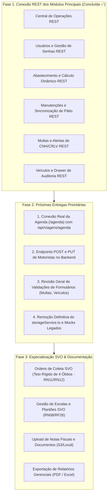

# Documentação do Front-end

Documento único e canônico do front-end da plataforma de Gestão de Frotas e Transportes da Fundação de Saúde Parreiras Horta (FSPH). Atualize-o a cada nova tela, refatoração ou alteração arquitetural.

---

## 1. Stack Tecnológica
- **React 19 + TypeScript (modo estrito) + Vite 8**
- **Tailwind CSS v4 (`@tailwindcss/vite`)** com tokens institucionais centralizados exclusivamente na diretiva `@theme` em `src/styles/global.css` (zero arquivos `.css` secundários e zero diretivas `@apply`).
- **Design System em TypeScript**: Variantes estritamente tipadas com `class-variance-authority` (`cva` + `VariantProps`) e fusão inteligente de classes com `clsx` + `tailwind-merge` (`src/utils/cn.ts`).
- **Padronização e Qualidade de Código**: `prettier` + `prettier-plugin-tailwindcss` para ordenação automática e determinística das classes utilitárias no salvamento.
- **Roteamento & RBAC**: `react-router-dom` v6 com guardas hierárquicos para autenticação e perfis de acesso.
- **Ícones Oficiais**: `lucide-react` para iconografia vetorial corporativa (proibido o uso de emojis).
- **Testes Automatizados**: **Vitest + React Testing Library** para testes unitários e de integração de componentes, páginas e contratos de API.

---

## 2. Como Rodar & Conectividade com a API REST

```bash
cd src/frontend
npm install
npm run dev          # Inicia o servidor de desenvolvimento em http://localhost:5173/
npm run build        # Valida tipos TypeScript (tsc -b) e compila bundle de produção
npm test             # Executa a suíte de testes automatizados do frontend (Vitest)
npm run format       # Formata o código e ordena classes Tailwind CSS com Prettier
npm run format:check # Verifica conformidade de formatação sem alterar arquivos
```

> [!IMPORTANT]
> **Atenção aos desenvolvedores**:
> 1. Ao atualizar ou clonar a branch, certifique-se de executar `npm install` na pasta `src/frontend`.
> 2. Crie ou configure o arquivo `src/frontend/.env` com a variável `VITE_API_URL=http://localhost:3000/api` para comunicação com o back-end Express local.

### Status Geral de Conexão à API REST
O front-end está **conectado e homologado com o back-end para todos os módulos operacionais e administrativos**:
- **Autenticação & Sessão**: `POST /api/auth/login`, `GET /api/auth/me`, `PATCH /api/auth/senha`.
- **Veículos**: `GET /api/veiculos`, `POST /api/veiculos`, `PUT /api/veiculos/:id`, `PATCH /api/veiculos/:id/status`, além do Drawer lateral e atalhos contextuais integrados.
- **Motoristas**: `GET /api/motoristas` com dados relacionais e alerta computado de CNH.
- **Viagens Operacionais**: `GET /api/viagens`, agendamento, início, finalização com odômetro e cancelamento via API.
- **Solicitações de Viagem**: `GET /api/solicitacoes-viagem`, criação, consulta de disponibilidade (`SCRUM-73`), aprovação e recusa com justificativa (`SCRUM-74`).
- **Unidades & Gestores**: `GET /api/unidades`, `GET /api/unidades/gestores`, `POST /api/unidades/:id/gestores`, `DELETE /api/unidades/:id/gestores/:gestorId` (BL15 / SCRUM-142).
- **Central de Operações (Início)**: `GET /api/dashboard` (BL34) e `solicitacoesApi.listar('PENDENTE_APROVACAO')`.
- **Usuários**: `GET /api/usuarios` (paginado, busca e filtros), `POST /api/usuarios`, `PATCH /api/usuarios/:id`, `PATCH /api/usuarios/:id/senha`.
- **Abastecimento**: `POST /api/abastecimentos`, `GET /api/abastecimentos/veiculo/:id` com sanitização Zod `.strict()`.
- **Manutenções**: `POST /api/manutencoes`, `PUT /api/manutencoes/:id`, `PATCH /api/manutencoes/:id/status`, `DELETE /api/manutencoes/:id`, `GET /api/manutencoes/veiculo/:id` com bloqueio e liberação de pátio sincronizados.
- **Multas & Infrações**: `GET /api/multas`, `POST /api/multas`, `PUT /api/multas/:id`, `DELETE /api/multas/:id`, `GET /api/documentos/vencimentos` (RN15).
- **Capacidade SVO (BL30 / SCRUM-108)**: `GET /api/veiculos/svo/ocupacao` alimenta a ocupação (`x/y vagas ocupadas`) e a mensagem de bloqueio (veículo lotado, em manutenção ou em deslocamento) no modal Agendar Viagem, operação SVO. A consulta exibe carregamento e erro, sem habilitar o agendamento SVO antes da integração com as solicitações.
- **Agenda**: O módulo `/agenda` é o único que permanece com estrutura visual de Gantt consumindo dados simulados (`agendaMock.ts`), aguardando endpoint especializado de consolidação de janelas de ocupação da API.

---

## 3. Estrutura de Pastas

```
src/frontend/
├─ public/assets/        logos e ícones institucionais
├─ .prettierrc           configuração do Prettier + prettier-plugin-tailwindcss
└─ src/
   ├─ contexts/          AuthContext (estado global da sessão e usuário logado)
   ├─ styles/            global.css (única folha de estilo: @import "tailwindcss", @theme e @layer base)
   ├─ utils/             cn.ts (helper clsx + tailwind-merge para resolução de conflitos de classes)
   ├─ components/
   │  ├─ ui/             Design System tipado (Button, Card, Badge, IdBadge, Avatar, Field, Input, Select,
   │  │                  Modal, ModalForm, Drawer, FilterBar, PlacaMercosul, Table, TableToolbar,
   │  │                  TableFilterCollapse, Pagination, MetricCard, Alert, PageHeader, ConfirmDialog,
   │  │                  EmptyState, icons)
   │  └─ layout/         AppLayout (sidebar retrátil com divisão de domínios, drawer mobile e topbar) e ErrorLayout
   ├─ pages/             uma página por rota + subpastas de modais/drawers por domínio e testes (*.test.tsx)
   │  ├─ veiculos/       DrawerDetalhesVeiculo.tsx, ModalVeiculo.tsx e ModalManutencoesVeiculo.tsx
   │  ├─ viagens/        DrawerDetalhesViagem.tsx
   │  ├─ solicitacoes/   ModalAnaliseSolicitacao.tsx e ModalNovaSolicitacao.tsx
   │  ├─ abastecimento/  ModalAbastecimento.tsx
   │  ├─ multas/         ModalMulta.tsx
   │  └─ usuarios/       GestoresUnidadesSecao.tsx
   ├─ routes/            index.tsx (roteamento, redirecionamentos e navegação) e guards.tsx (RBAC)
   ├─ services/
   │  ├─ api/            http.ts (cliente HTTP genérico), dashboardApi, veiculosApi, motoristasApi,
   │  │                  viagensApi, solicitacoesApi, unidadesApi, usuariosApi, manutencoesApi,
   │  │                  abastecimentosApi, multasApi, documentosApi
   │  ├─ mocks/          dados iniciais padronizados e agendaMock.ts
   │  └─ storageService.ts cache local mantido estritamente para suporte da Agenda e retrocompatibilidade
   └─ types/             interfaces TypeScript espelhando fielmente as entidades relacionais do banco
```

---

## 4. Arquitetura de Estilização e Design System (Tailwind CSS v4 + TypeScript)

O front-end adota diretrizes estritas de engenharia para evitar divergências visuais e garantir manutenção previsível:

1. **Reutilização via Componentes TypeScript (Zero `@apply`)**:
   - É expressamente proibida a criação de classes customizadas com `@apply` ou arquivos `.css` individuais por tela. Toda abstração visual reside nos componentes tipados de `src/components/ui/`.
2. **Resolução de Conflitos (`cn`) e Variantes Tipadas (`CVA`)**:
   - `cn(...inputs)` combina `clsx` e `tailwind-merge`. Qualquer componente visual aceita a prop `className` e a última classe prevalece em especificidade.
   - Variantes visuais são geridas por `class-variance-authority` (`cva`), provendo autocompletion e validação em tempo de compilação.
3. **Proibição de Classes Dinâmicas Interpoladas**:
   - Interpolações de string como `` `bg-${color}-500` `` quebram a análise estática do compilador do Tailwind. Mapeamentos de status e enums são realizados exclusivamente via dicionários de constantes (`Record<Key, string>`) ou variantes CVA.
4. **Tokens Centralizados (`@theme`) e Mobile-First**:
   - Cores corporativas, sombras, raios e tipografia são definidos na diretiva `@theme` em `src/styles/global.css`.
   - Layouts seguem abordagem mobile-first com breakpoints declarativos (`sm:`, `md:`, `lg:`).
   - Estilos inline (`style={{ ... }}`) são permitidos unicamente para valores matemáticos computados dinamicamente em runtime (ex.: largura e deslocamento percentual das barras da Agenda e barras de proporção).

### 4.1 Catálogo de Componentes do Design System (`src/components/ui/`)
- **`Button` (`Button.tsx`)**:
  - Variantes (`variant`): `'primary'` (azul institucional), `'ghost'`, `'outline'`, `'danger'`, `'success'`.
  - Tamanhos (`size`): `'md'` (38px, padrão para barras de ferramentas e formulários) e `'sm'` (32px, para ações inline em tabelas).
- **`Badge` e `IdBadge` (`Badge.tsx`)**:
  - `Badge`: pílula semântica com indicador circular e variantes (`tone`: `'success'` | `'warning'` | `'info'` | `'danger'` | `'neutral'` | `'purple'`).
  - `IdBadge`: selo monoespaçado corporativo para códigos de registros (`#1042`, placas, `OS-0012`).
- **`MetricCard` (`MetricCard.tsx`)**:
  - Card executivo de KPI no topo das telas operacionais (`label`, `value`, `subtitle`, `badge`, `icon`, `tone`, `footer`).
- **`ConfirmDialog` (`ConfirmDialog.tsx`)**:
  - Modal padronizado para confirmação de ações críticas ou destrutivas (`variant="danger"` | `"primary"`), substituindo diálogos nativos do navegador (`window.confirm`).
- **`Drawer` (`Drawer.tsx`)**:
  - Painel lateral deslizante (sheet) ancorado à direita com backdrop escurecido, bloqueio de scroll e tecla `Escape` para inspeção profunda sem sair do contexto da listagem.
- **`PlacaMercosul` (`PlacaMercosul.tsx`)**:
  - Renderizador visual oficial de placas padrão Mercosul e convencional cinza (`sm` e `md`).
- **`Table`, `TableToolbar`, `TableFilterCollapse` e `Pagination` (`Table.tsx`)**:
  - Conjunto responsivo para tabelas de dados com cabeçalhos estruturados, barra de filtros expansível no mobile e paginação sincronizada.

### 4.2 Padrão Canônico de Ações em Tabelas e Alinhamentos Visuais
Para eliminar divergências visuais e garantir ergonomia homogênea em todas as telas:
1. **Alinhamento do Cabeçalho e Células**:
   - A coluna de ações na tabela possui cabeçalho alinhado à esquerda (`<th>AÇÕES</th>` ou `<th>Ações</th>`), já que a regra base da tabela aplica `[&_th]:text-left`.
   - As células de dados contendo os botões de ação utilizam rigorosamente container flex alinhado à esquerda:
     ```tsx
     <td>
       <div className="flex items-center justify-start gap-1.5">
         {/* Botões do Design System */}
       </div>
     </td>
     ```
   - Isso evita o desalinhamento visual onde o título da coluna ficava à esquerda e os botões à direita com espaços vazios desproporcionais.
2. **Cores e Semântica dos Botões de Tabela (`size="sm"`)**:
   - **Ação de Avanço de Fluxo / Transição Primária**: `variant="primary"` (azul corporativo). Ex.: `Iniciar` e `Concluir` em Manutenções; `Iniciar Viagem` e `Finalizar` em Viagens.
   - **Ação de Edição / Visualização Detalhada**: `variant="outline"`. Ex.: `Editar` em Veículos, Manutenções e Multas.
   - **Ação Crítica / Destrutiva**: `variant="danger"`. Ex.: `Excluir` em Manutenções e Multas (sempre vinculada ao `<ConfirmDialog>`).
3. **Clique na Linha vs. Ações Inline**:
   - Quando a tabela suporta painel lateral (Drawer) para detalhes da entidade (ex.: `VeiculosPage` e `ViagensPage`), a linha inteira da tabela é interativa (`cursor-pointer`).
   - Nesses casos, o botão inline de ação na tabela deve ser focado na mutação direta (ex.: botão `Editar` em Veículos), evitando botões redundantes de "Detalhes" ou "Manutenções" que poluíam a visualização.

---

## 5. Rotas e Permissões (RBAC)

| Rota | Página | Tipo de Acesso | Permissões / Regras |
|---|---|---|---|
| `/login` | `LoginPage` | Pública (`RotaPublica`) | Visitantes (usuários autenticados são redirecionados para `/inicio`) |
| `/` | Redirecionamento | Protegida | Redireciona para `/inicio` |
| `/inicio` | `HomePage` | Protegida (`RotaProtegida`) | Todos os perfis (visão operacional, KPIs do banco via `dashboardApi` e solicitações pendentes) |
| `/dashboard` | Redirecionamento | Protegida (`RotaProtegida`) | Redireciona para `/inicio` (Central de Operações consolidada) |
| `/solicitacoes` | `SolicitacoesPage` | Protegida (`RotaProtegida`) | Triagem, análise de disponibilidade (`SCRUM-73`), despacho, aprovação e recusa |
| `/viagens` | `ViagensPage` | Protegida (`RotaProtegida`) | Acompanhamento da frota em trânsito, manifesto de bordo e Drawer lateral |
| `/agenda` | `AgendaPage` | Protegida (`RotaProtegida`) | Alocação temporal em Gantt (Hoje, Semana, Mês) |
| `/veiculos` | `VeiculosPage` | Protegida (`RotaProtegida`) | Frota ativa, edição rápida, Drawer lateral com métricas e histórico |
| `/abastecimento` | `AbastecimentoPage` | Protegida (`RotaProtegida`) | Lançamentos de combustível, custo dinâmico e distribuição por frota |
| `/manutencoes` | `ManutencoesPage` | Protegida (`RotaProtegida`) | Histórico de ordens de serviço, início, conclusão, edição e exclusão |
| `/multas` | `MultasPage` | Protegida (`RotaProtegida`) | Infrações, vinculação a motoristas, edição, exclusão e alerta CNH/CRLV |
| `/equipe` | `EquipePage` | Restrita por Perfil (`RotaPorPerfil`) | Exclusivo para `ADMINISTRADOR` (abas de Motoristas e Usuários com gestão de senhas e status) |
| `/motoristas` | Redirecionamento | Protegida | Redireciona para `/equipe?aba=motoristas` |
| `/usuarios` | Redirecionamento | Restrita por Perfil | Redireciona para `/equipe?aba=usuarios` |
| `/sobre` | `SobreNosPage` | Protegida (`RotaProtegida`) | Apresentação institucional da FSPH, unidades operacionais e créditos |
| `/404`, `/500`, `/403`| Páginas de Erro | Pública / Erro | Telas ilustradas e semânticas para erros HTTP |
| qualquer outra | `NotFoundPage` | Protegida | Captura de rotas inexistentes |

---

## 6. Arquitetura de Autenticação e Sessão

A autenticação utiliza tokens **JWT (JSON Web Tokens)** fornecidos pelo endpoint `/api/auth/login`.

- **Armazenamento Seguro**: O token é persistido no `localStorage` sob a chave `'fsph.token'` pelo utilitário `tokenStorage`.
- **Injeção de Cabeçalho**: O wrapper `src/frontend/src/services/api/http.ts` intercepta todas as requisições autenticadas e injeta `Authorization: Bearer <token>`.
- **Tratamento de Sessão Expirada (401)**: Respostas `401 Unauthorized` limpam o token e emitem o evento customizado `auth:expirada`, redirecionando imediatamente o usuário para `/login` com preservação da rota de origem em `location.state.de`.
- **Recuperação de Sessão (F5)**: Ao carregar qualquer tela, o `AuthContext` executa `authApi.me()` (`GET /api/auth/me`). Se o token for válido, a sessão é restaurada sem interrupção.
- **Credenciais de Teste**: Todos os usuários de teste do banco usam a senha padrão **`Senha@123`**.

---

## 7. Origem dos Dados e Matriz de Mapeamento REST

| Módulo / Tela | Origem Atual | Contrato REST Oficial | Mutações e Funcionalidades |
|---|---|---|---|
| **Autenticação** | API REST Real | `authApi.ts` | `POST /api/auth/login`, `GET /api/auth/me`, `PATCH /api/auth/senha`. |
| **Central de Operações** (`/inicio`) | API REST Real | `dashboardApi.ts`, `solicitacoesApi.ts` | Consome `GET /api/dashboard` (BL34) e `GET /api/solicitacoes-viagem?status=PENDENTE_APROVACAO`. |
| **Veículos** (`/veiculos`) | API REST Real | `veiculosApi.ts` | `GET /api/veiculos`, `POST /api/veiculos`, `PUT /api/veiculos/:id`, `PATCH /api/veiculos/:id/status`. |
| **Motoristas** (`/motoristas`) | API REST Real | `motoristasApi.ts` | `GET /api/motoristas` com dados relacionais; cadastro aguarda `POST /api/motoristas`. |
| **Viagens** (`/viagens`) | API REST Real | `viagensApi.ts` | Agendamento, início, conclusão com odômetro (`km_final >= km_inicial`) e cancelamento. |
| **Solicitações** (`/solicitacoes`) | API REST Real | `solicitacoesApi.ts` | `GET /api/solicitacoes-viagem`, criação, consulta de disponibilidade, aprovação e recusa. |
| **Unidades & Gestores** | API REST Real | `unidadesApi.ts` | Isolamento operacional e associação de gestores por unidade (`BL15`). |
| **Manutenções** (`/manutencoes`) | API REST Real | `manutencoesApi.ts` | `POST /api/manutencoes`, `PUT /:id`, `PATCH /:id/status`, `DELETE /:id`, `GET /veiculo/:id`. |
| **Abastecimento** (`/abastecimento`) | API REST Real | `abastecimentosApi.ts` | `POST /api/abastecimentos` com Zod estrito e `GET /api/abastecimentos/veiculo/:id`. |
| **Multas & Infrações** (`/multas`) | API REST Real | `multasApi.ts`, `documentosApi.ts` | `GET /api/multas`, `POST /api/multas`, `PUT /:id`, `DELETE /:id` e `GET /api/documentos/vencimentos`. |
| **Usuários** (`/equipe?aba=usuarios`) | API REST Real | `usuariosApi.ts` | `GET /api/usuarios` (paginado), `POST`, `PATCH /:id`, `PATCH /:id/senha`. |
| **Agenda** (`/agenda`) | Mocks (`agendaMock.ts`) | Estrutura de Gantt em transição para `/api/viagens/agenda`. |
| **Sobre Nós** (`/sobre`) | Componente Estático | Apresentação institucional da FSPH e Squad 21. |

---

## 8. Central de Operações / Início (`/inicio`)

A Central de Operações substituiu e consolidou integralmente a antiga `DashboardPage.tsx`, oferecendo uma experiência executiva e operacional unificada:
- **KPIs do Pátio e Operação**: Consome `dashboardApi.obter()` (`GET /api/dashboard`), exibindo:
  - Total de Solicitações Pendentes;
  - Viagens em Andamento no momento;
  - Veículos Disponíveis no pátio (com segregação visual entre `Frota Administrativa` e `SVO`);
  - Alertas Críticos da Operação (veículos retidos em manutenção e motoristas com habilitação vencida).
- **Fila de Solicitações para Triagem**: Consome `solicitacoesApi.listar('PENDENTE_APROVACAO')`, exibindo diretamente no painel a lista de pedidos aguardando despacho com botões de ação rápida.
- **Ações Rápidas de Topo**: Atalho com `<Button variant="primary">Nova Solicitação</Button>`, abrindo o modal de solicitação institucional.
- **Testes Automatizados**: Coberta por `HomePage.test.tsx` com verificação de estados de carregamento, renderização de cards e tratamento de erros de API.

---

## 9. Tela de Veículos (`/veiculos`)

Tabela relacional `veiculos`, espelhando `docs/dicionario-de-dados.md`:

| Coluna no banco | Tipo | Regra de Negócio | Campo no Front |
|---|---|---|---|
| `id` | serial, PK | Identificador único autoincrementado | `id` (inteiro) |
| `placa` | varchar(10), unique | Formato Mercosul ou convencional | `placa` (renderizada via `<PlacaMercosul />`) |
| `modelo` | varchar(100) | Marca e modelo oficial | `modelo` |
| `tipo_frota` | enum | `ADMINISTRATIVA` ou `SVO` | `tipo_frota` |
| `capacidade_maxima` | integer, >= 0 | Capacidade de lotação/passageiros | `capacidade_maxima` |
| `status` | varchar(30) | `DISPONIVEL`, `EM_USO`, `MANUTENCAO` | `status` |

### Inovações e Padrões de Interface em Veículos:
1. **Linha Interativa & Ação Inline**:
   - O clique em qualquer linha da tabela abre o `DrawerDetalhesVeiculo`.
   - A coluna de ações na tabela possui o cabeçalho `AÇÕES` alinhado à esquerda e contém unicamente o botão `<Button variant="outline" size="sm">Editar</Button>`.
   - O botão `Editar` abre o `ModalVeiculo` em modo de edição (`veiculoParaEditar`), pré-carregando os dados e alterando o título para "Editar Veículo" e o botão para "Salvar Alterações".
   - Mutações de edição são persistidas no PostgreSQL via `PUT /api/veiculos/:id` com recarregamento automático da lista.
2. **`DrawerDetalhesVeiculo.tsx` (Painel Lateral de Auditoria)**:
   - Exibe a placa Mercosul em destaque, modelo, tipo de frota e status operacional.
   - Cards de métricas rápidas: Quilometragem acumulada, Consumo médio e Capacidade máxima.
   - **Histórico Recente de Manutenções**: Consome `manutencoesApi.listarPorVeiculo(veiculo.id)`, exibindo as últimas OS com botão "Ver todas" que direciona para `/manutencoes`.
   - **Ações Rápidas Padronizadas**: Grid limpo de 2 colunas com botões do Design System:
     - `Registrar Abastecimento`: abre `ModalAbastecimento` pré-selecionando o veículo.
     - `Registrar Multa`: abre `ModalMulta` pré-selecionando o veículo.
3. **`ModalVeiculo.tsx`**:
   - Suporta tanto a criação (`POST /api/veiculos`) quanto a atualização (`PUT /api/veiculos/:id`), com validação de placa, modelo, tipo de frota e capacidade máxima.

---

## 10. Tela de Gestão de Equipe (`/equipe`)

Centraliza a administração de pessoas da FSPH em interface com controle de acesso exclusivo para `ADMINISTRADOR`.

### Estrutura de Abas ("Pill Segmented"):
- **Aba Motoristas (`/equipe?aba=motoristas`)**:
  - Consome `GET /api/motoristas` com dados relacionais de `usuarios.nome`.
  - 4 cards de topo: `Total de Motoristas`, `Frota`, `SVO` e `CNH Vencida`.
  - Alerta computado no front-end para condutores com CNH expirada ou a vencer.
  - Filtros por tipo de motorista (`FROTA` / `SVO`) e status (`DISPONIVEL`, `DESIGNADO`, `EM_VIAGEM`).
- **Aba Usuários (`/equipe?aba=usuarios`)**:
  - Consome `GET /api/usuarios` com suporte a paginação real do backend (`limite`, `pagina`), busca textual e filtro de perfil.
  - Ação rápida para Ativar / Desativar usuário via `PATCH /api/usuarios/:id` (com proteção de segurança impedindo que o administrador logado desative sua própria conta).
  - Modal administrativo para Redefinir Senha (`PATCH /api/usuarios/:id/senha`) com validação de regras de senha forte.
- **Seção de Gestores por Unidade (BL15)**:
  - Localizada abaixo da tabela de usuários, consome `GET /api/unidades/gestores` e permite associar/remover gestores institucionais (SVO, HEMOSE, LACEN) conforme as restrições da regra de negócio.

---

## 11. Tela de Solicitações de Viagem (`/solicitacoes`)

Conecta a demanda dos setores hospitalares ao despacho central da frota:
1. **Criação da Solicitação (`PENDENTE_APROVACAO`)**: Registro com origem, destino, finalidade, período desejado e unidade solicitante.
2. **Análise de Disponibilidade (`SCRUM-73`)**: O gestor avalia em tempo real a frota livre e os motoristas habilitados antes de decidir.
3. **Aprovação e Recusa Auditável (`SCRUM-74`)**:
   - Aprovação (`PATCH /api/solicitacoes-viagem/:id/aprovar`): habilita o atalho direto para agendamento de viagem.
   - Recusa (`PATCH /api/solicitacoes-viagem/:id/recusar`): exige justificativa textual (`motivo_recusa`), registrada no banco para auditoria.

---

## 12. Tela de Viagens (`/viagens`)

Controle das missões operacionais nas tabelas `viagens_frota` e `ordens_svo`:
- **Ciclo de Vida da Viagem**: `AGENDADA` ➔ `EM_ANDAMENTO` ➔ `CONCLUIDA` ou `CANCELADA`.
- **Controle Estrito de Odômetro**:
  - Saída: registro do odômetro inicial (`km_inicial`).
  - Retorno: validação obrigatória de `km_final >= km_inicial`, apurando a quilometragem percorrida e atualizando o veículo de volta para `DISPONIVEL`.
- **Drawer de Detalhes da Viagem (`DrawerDetalhesViagem.tsx`)**:
  - Manifesto de bordo completo, rota, motorista responsável, veículo alocado, solicitante e cronômetro de duração.

---

## 13. Tela de Manutenções (`/manutencoes`)

Conectada às ordens de serviço da frota via `manutencaoRoutes.ts`:
- **Título Oficial**: "Histórico de manutenções" (padronizado com os demais módulos históricos).
- **Cards de Métricas Operacionais**:
  1. *Em oficina agora*: quantidade de veículos bloqueados para operação com status `EM_ANDAMENTO`.
  2. *Total investido*: soma financeira de todas as ordens de serviço cadastradas.
  3. *Preventivas vs Corretivas*: proporção entre manutenções programadas e emergenciais.
  4. *Concluídas no mês*: ordens finalizadas com sucesso no mês de referência.
- **Identificador de Registro**: Formato padronizado `<IdBadge id="MAN-0001" />`.
- **Workflow de Oficina e Sincronização de Pátio**:
  - Ordem `AGENDADA`: exibe botão `<Button variant="primary" size="sm">Iniciar</Button>`, que atualiza a ordem para `EM_ANDAMENTO` e automaticamente bloqueia o veículo no pátio para status `MANUTENCAO`.
  - Ordem `EM_ANDAMENTO`: exibe botão `<Button variant="primary" size="sm">Concluir</Button>`, que finaliza o serviço e libera atomicamente o veículo para `DISPONIVEL`.
- **Ações Padronizadas na Tabela**:
  - Cabeçalho `AÇÕES` alinhado à esquerda.
  - Botões inline alinhados à esquerda: `Iniciar` (azul primário), `Concluir` (azul primário), `Editar` (outline), `Excluir` (danger com `<ConfirmDialog>`).
  - O status é exibido exclusivamente na coluna **Status** com `<Badge>`, sem rótulos soltos na coluna de ações.

---

## 14. Tela de Abastecimento (`/abastecimento`)

Controle de suprimento de combustível da frota FSPH:
- **Título Oficial**: "Registros de Abastecimentos".
- **KPIs em Tempo Real**:
  - *Volume Total Abastecido*: soma dos litros registrados.
  - *Gasto Total Acumulado*: total financeiro em combustíveis.
  - *Custo Médio por Litro*: apuração ponderada de preço por litro.
  - *Distribuição de Gastos por Frota*: separação analítica de custos entre `Frota Administrativa` e `SVO`.
- **Modal de Lançamento (`ModalAbastecimento.tsx`)**:
  - Consome `POST /api/abastecimentos` com validação estrita (Zod `.strict()`).
  - Preenchimento de veículo, data/hora, tipo de combustível (`GASOLINA`, `ETANOL`, `DIESEL`, `GNV`), quantidade de litros, valor total e odômetro atualizado.

---

## 15. Tela de Multas & Infrações (`/multas`)

Gestão de autuações de trânsito e controle preventivo de habilitações:
- **Painel de Alerta Preventivo (RN15)**:
  - Consome `GET /api/documentos/vencimentos`, exibindo quadro de alerta contextual para condutores com CNH a vencer e veículos com CRLV a expirar em até 30 dias.
- **Ações na Tabela**:
  - Cabeçalho `AÇÕES` alinhado à esquerda.
  - Botões inline: `<Button variant="outline" size="sm">Editar</Button>` e `<Button variant="danger" size="sm">Excluir</Button>`.
  - Exclusão protegida pelo `<ConfirmDialog>`.
- **Mutações REST**:
  - Conectada aos endpoints `GET /api/multas`, `POST /api/multas`, `PUT /api/multas/:id` e `DELETE /api/multas/:id`.

---

## 16. Tela de Agenda (`/agenda`)

Central de planejamento visual em formato Gantt e calendário:
- **Modo "Hoje"**: Grade de 05:00 às 20:00 com marcador vertical em tempo real ("Agora"), veículos no eixo Y e blocos proporcionais aos minutos de percurso.
- **Modo "Semana"**: Linha do tempo de 7 dias com tooltips flutuantes de trajeto e horário no hover.
- **Modo "Mês"**: Calendário com badges de gestão por exceção (`Normal`, `Pico`, `Gargalo`).
- **Estado Atual**: Mantida consumindo `agendaMock.ts` em transição para `/api/viagens/agenda`.

---

## 17. Tela "Sobre Nós" (`/sobre`)

Apresentação institucional acessível pela topbar e rodapé:
- Missão oficial da Fundação de Saúde Parreiras Horta (FSPH).
- Contextualização das unidades hospitalares atendidas: SVO, HEMOSE e LACEN.
- Créditos institucionais de desenvolvimento: **Residência em Software III — Squad 21**.

---

## 18. Inconsistências Conhecidas & Pontos de Atenção (Known Inconsistencies)

Mapeamento preventivo de pontos a serem tratados em revisões subsequentes:

1. **Validação de Cadastro de Multas (`ModalMulta.tsx`)**:
   - Atualmente possui validação apenas de preenchimento dos campos básicos.
   - *Ajustes necessários no roadmap*:
     - Inclusão de máscara monetária no campo de valor (atualmente `type="number"`).
     - Validação de formato/dígitos verificadores do Auto de Infração e código RENAINF/Detran.
     - Cruzamento automático entre data/hora da infração e o histórico de viagens para identificar e sugerir automaticamente o condutor responsável.
2. **Cadastro e Edição de Motoristas (`ModalMotorista.tsx` e Backend)**:
   - A listagem consome a API REST (`GET /api/motoristas`).
   - A criação (`POST /api/motoristas`) e edição (`PUT /api/motoristas/:id`) ainda não possuem endpoints implementados no backend Express; o modal do frontend aguarda essas mutations para persistir motoristas no PostgreSQL.
3. **Agenda com Dados Mockados (`agendaMock.ts`)**:
   - A tela de Agenda permanece com dados simulados locais para viabilizar a experiência do Gantt enquanto o endpoint `/api/viagens/agenda` não é finalizado.
4. **Resíduo de `storageService.ts`**:
   - Mantido no projeto para retrocompatibilidade e suporte da Agenda mockada. Todas as telas principais (Home, Veículos, Equipe, Viagens, Solicitações, Manutenções, Abastecimento e Multas) já foram desvinculadas dele.
5. **Sincronização de Frota Concorrente (Multi-aba)**:
   - As alterações de status de veículos geradas por início/conclusão de manutenções e viagens são persistidas no PostgreSQL com integridade transacional, mas abas abertas em paralelo exigem recarregamento ou ação do usuário para refletir a mudança de pátio (previsto polling reativo ou WebSocket futuro).

---

## 19. Status da Suíte de Testes Automatizados

- **Testes de Backend**:
  - 168 testes automatizados passando em 15 arquivos de suíte (`npm --prefix src/backend test -- --run`).
  - Cobertura completa de rotas, controllers, services, transações de pátio e auditoria para: autenticação, veículos, motoristas, viagens, solicitações, unidades, dashboard, manutenções, multas, documentos e abastecimento.
- **Testes de Frontend**:
  - 14 testes automatizados passando em 7 arquivos de suíte (`npm --prefix src/frontend test -- --run`).
  - Validação de clientes de API (`veiculosApi`, `manutencoesApi`, `abastecimentosApi`, `multasApi`, `usuariosApi`), contratos de dados e integração de páginas centrais (`HomePage.test.tsx`, `UsuariosPage.test.tsx`).
- **Build de Produção**:
  - Validação estrita de tipagem TypeScript e geração de bundle limpo sem avisos (`npm --prefix src/frontend run build`).

---

## 20. Roadmap Estratégico e Próximos Passos (Priorizado)



1. **Agenda Interativa REST (`/agenda`)**:
   - Desenvolver rota `/api/viagens/agenda?data=...` retornando as janelas de ocupação de veículos e motoristas para alimentar o Gantt em tempo real.
2. **Mutação de Motoristas no Backend**:
   - Implementar `POST /api/motoristas` e `PUT /api/motoristas/:id` no Express com validação de número e categoria de CNH, liberando o cadastro direto na aba `/equipe?aba=motoristas`.
3. **Revisão e Endurecimento de Formulários**:
   - Implementar máscaras e validações avançadas (Zod / React Hook Form) no modal de multas (`ModalMulta.tsx`), abastecimento e veículos.
4. **Descontinuação Definitiva do Storage Local**:
   - Exclusão de `storageService.ts` e arquivos de mock legados após a conexão da Agenda.
5. **Especialização do Módulo SVO**:
   - Fluxo completo de ordens de remoção com trava máxima de 4 corpos e escalas de plantão 24h.
